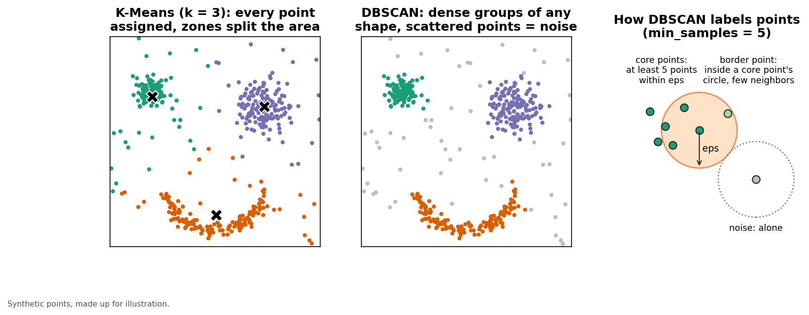

:::::::::::::::::::::::::::::::::::::: questions

- What is spatial clustering and when is it useful?
- Why must coordinates be in meters before clustering?
- How do K-Means, hierarchical clustering, DBSCAN and HDBSCAN differ?
- When is a cluster of points really a hotspot?

::::::::::::::::::::::::::::::::::::::::::::::::

::::::::::::::::::::::::::::::::::::: objectives

- Prepare point data for clustering by reprojecting to a meter based CRS
- Find dense hotspots with DBSCAN and HDBSCAN and recognize noise points
- Divide points into zones with K-Means and choose k with the elbow method
- Choose a clustering method that fits the research question
- Explain how each method works, what it assumes, and how to choose its parameters
- Recognize the population at risk, data collection effects and other pitfalls in hotspot maps

::::::::::::::::::::::::::::::::::::::::::::::::

## Why spatial clustering?

Clustering finds groups of points that sit close together: crime hotspots, disease outbreaks,
clusters of archaeological finds, or concentrations of businesses. It turns thousands of points into
a few areas you can describe and compare.

| Method | You choose | Noise points? | Best for |
|---|---|---|---|
| K-Means | Number of clusters (k) | No, every point is assigned | Dividing an area into zones |
| Hierarchical | Number of clusters or a cut height | No | Seeing structure at several scales (small datasets) |
| DBSCAN | Search radius (`eps`) and `min_samples` | Yes | Hotspots of any shape at a known distance |
| HDBSCAN | `min_cluster_size` | Yes | Hotspots with varying density |

The notebooks use about 200,000 crime reports from the
[Chicago Data Portal](https://data.cityofchicago.org/) and focus on robbery.

{alt="Three panels of the same synthetic points: three dense groups of different sizes and shapes, one of them long and curved, plus scattered points across the whole area. Left, K-Means with k equal to 3: every point is colored, the area is split into three regions, and the scattered points are assigned to the nearest group. Middle, DBSCAN: the three dense groups are colored, the curved group is kept whole, and the scattered points are gray noise. Right, a close-up explaining DBSCAN with a circle of radius eps around points: core points with at least five points inside a circle of radius eps, a border point inside a core point's circle but with few neighbors of its own, and an isolated noise point."}

## Points, patterns and the population at risk

Clustering looks for places where **events** (robberies, disease cases, archaeological finds) are
concentrated. It is related to, but different from, the previous episode: spatial autocorrelation asks
whether **values attached to areas** (such as median age by county) are similar among neighbors.

Before calling a cluster a "hotspot", ask what you are comparing it with. Events happen where people are: a
busy downtown has more robberies than a quiet suburb partly because far more people pass through it. A
dense cluster of points may reflect the **population at risk** rather than an unusually high risk. Common
ways to handle this are to compare with a background (rates per resident or per visitor, or a control set
of points such as all reported crimes), or to aggregate the points to areas and analyze rates with the
methods from the PySAL episode.

How the data were collected shapes them too. Crime reports reflect reporting and policing as well as crime
itself, and the Chicago portal shows locations at the **block level only** to protect victims' privacy, so
many reports share exactly the same coordinates.

:::::::::::::::::::::::::::::::::::::::::::::::::::::::::::::::::::: instructor

The most common mistake is clustering raw latitude and longitude. Show what `eps=1000` means in
meters versus degrees before running DBSCAN. Pause after each method and compare maps side by side.

::::::::::::::::::::::::::::::::::::::::::::::::::::::::::::::::::::::::::::::::

## 1. Load points and reproject to meters

```python
import pandas as pd
import geopandas as gpd
import numpy as np

# read the CSV straight from GitHub into memory (nothing to download)
crimes = pd.read_csv("https://raw.githubusercontent.com/SpatialTurn/DataAnalysis/main/data/CrimesChicago20220225.csv")
crimes.columns = crimes.columns.str.strip()
robbery = crimes[crimes["PRIMARY DESCRIPTION"] == "ROBBERY"].dropna(subset=["LATITUDE", "LONGITUDE"])

robbery = gpd.GeoDataFrame(
    robbery,
    geometry=gpd.points_from_xy(robbery["LONGITUDE"], robbery["LATITUDE"]),
    crs="EPSG:4326",
).to_crs(epsg=32616)          # UTM zone 16N: x and y in meters

coords = np.column_stack([robbery.geometry.x, robbery.geometry.y])
```

Latitude and longitude are angles. One degree of longitude in Chicago is about 85 km while one
degree of latitude is about 111 km, so distances in degrees are distorted. Always reproject first.

## 2. DBSCAN: density based hotspots

```python
from sklearn.cluster import DBSCAN

db = DBSCAN(eps=1000, min_samples=50).fit(coords)   # eps in meters
robbery["dbscan"] = db.labels_                       # -1 means noise
```

A point with at least `min_samples` neighbors within `eps` meters is a core point; nearby core
points form a cluster. Choose `eps` with a k-distance plot (see notebook 5b).

## 3. HDBSCAN: no radius needed

```python
from sklearn.cluster import HDBSCAN

robbery["hdbscan"] = HDBSCAN(min_cluster_size=50, min_samples=10).fit_predict(coords)
```

## 4. K-Means: zones

```python
from sklearn.cluster import KMeans

robbery["kmeans"] = KMeans(n_clusters=6, n_init=10, random_state=42).fit_predict(coords)
```

## 5. Hierarchical clustering and the dendrogram

```python
from scipy.cluster.hierarchy import linkage, dendrogram, fcluster

sample = robbery.sample(2000, random_state=1)        # hierarchical is slow on large data
tree = linkage(np.column_stack([sample.geometry.x, sample.geometry.y]), method="ward")
dendrogram(tree, truncate_mode="lastp", p=20, no_labels=True)
sample["hier"] = fcluster(tree, t=6, criterion="maxclust")
```

Plot any result with `robbery.plot(column="dbscan", categorical=True, markersize=1)`.

## How the methods work

### DBSCAN

DBSCAN (Density-Based Spatial Clustering of Applications with Noise) sorts every point into one of three
kinds:

- a **core point** has at least `min_samples` points (counting itself) within `eps`;
- a **border point** lies within `eps` of a core point but does not have enough neighbors of its own;
- a **noise point** is neither, and gets the label `-1`.

Core points that are within `eps` of each other join the same cluster, so clusters can take any shape,
following a river or a commercial street.

**Choosing `eps`.** Make a **k-distance plot**: for every point, find the distance to its k-th nearest
neighbor (with k equal to `min_samples`), sort those distances and plot them. Most points sit on a flat part
of the curve; where the curve bends sharply upward (the "knee"), points start to be isolated. The distance
at the knee is a good first choice for `eps`.

```python
import matplotlib.pyplot as plt
from sklearn.neighbors import NearestNeighbors

k = 50                                                    # same as min_samples
dist, _ = NearestNeighbors(n_neighbors=k).fit(coords).kneighbors(coords)
plt.plot(np.sort(dist[:, -1]))
plt.ylabel(f"distance to neighbor {k} (m)")
plt.xlabel("points, sorted")
plt.show()
```

**Choosing `min_samples`.** Larger values ask for denser clusters and label more points as noise. With
thousands of points, values in the tens are common; with a few hundred, try 5 to 10.

DBSCAN's weakness is that one `eps` applies to the whole map, so it cannot find both a tight downtown cluster
and a looser suburban one at the same time.

### HDBSCAN

HDBSCAN (Hierarchical DBSCAN) avoids choosing `eps`. In effect it tries every value of `eps` at once, builds a
tree of how clusters split apart as the distance shrinks, and keeps the clusters that last over a wide range
of distances (the most **stable** ones). You set `min_cluster_size`, the smallest group worth calling a
cluster. It finds clusters of different densities, labels noise as `-1`, and reports how strongly each point
belongs to its cluster (`probabilities_`).

### K-Means

K-Means places k centers, assigns every point to its nearest center, moves each center to the mean of its
points, and repeats until nothing changes. It assumes clusters that are roughly round and of similar size,
and it assigns **every** point, so outliers pull the centers toward them. The result depends on where the
centers start; `n_init=10` runs ten starts and keeps the best one.

To choose k, plot the **inertia** (the total squared distance from points to their centers) for k = 2, 3, 4
and so on, and look for the elbow where adding clusters stops helping much. The **silhouette score**
(`sklearn.metrics.silhouette_score`, from -1 to 1) measures how well each point fits its own cluster compared
with the next nearest one; higher is better. On large datasets, compute it on a sample with
`sample_size=2000`.

### Hierarchical clustering

Agglomerative hierarchical clustering starts with every point as its own cluster and repeatedly merges the
two closest clusters. The **linkage** rule defines "closest": single linkage (the nearest pair of points,
which tends to make long chains), complete linkage (the farthest pair), average linkage, or **Ward** (the
merge that adds the least variance, which makes compact clusters). In the dendrogram, the height of each
join is the distance at which two groups merge; cutting the tree at a height gives the clusters. Memory use
grows with the square of the number of points, which is why the example uses a sample.

:::::::::::::::::::::::::::::::::::: challenge

## Challenge 1: K-Means or DBSCAN?

Map the K-Means and DBSCAN results side by side. Which one would you use to report
"robbery hotspots" to a city council, and why?

:::::::::::::::::::::::: solution

DBSCAN (or HDBSCAN). K-Means assigns every robbery to a zone, even isolated ones, so its "clusters"
cover the whole city. DBSCAN keeps only dense areas and labels scattered points as noise, which is
what a hotspot means.

:::::::::::::::::::::::::::::::::
::::::::::::::::::::::::::::::::::::::::::::::::

:::::::::::::::::::::::::::::::::::: challenge

## Challenge 2: Adjusting DBSCAN

Run DBSCAN with `eps=500` and `eps=1500` (meters). How do the number of clusters and the share of
noise points change?

:::::::::::::::::::::::: solution

```python
for eps in [500, 1500]:
    labels = DBSCAN(eps=eps, min_samples=50).fit(coords).labels_
    print(eps, labels.max() + 1, "clusters", f"{(labels == -1).mean():.0%} noise")
```

A smaller `eps` gives more, smaller clusters and more noise. A larger `eps` merges clusters into a
few large ones.

:::::::::::::::::::::::::::::::::
::::::::::::::::::::::::::::::::::::::::::::::::

## Pitfalls

- **Degrees instead of meters.** Always reproject first (Section 1).
- **Duplicate locations.** Block-level coordinates put many reports on the same spot. Every duplicate counts
  as a neighbor, which can make an area look denser than it is.
- **Parameters shape the result.** Report `eps`, `min_samples`, `min_cluster_size` or k, and check how the
  map changes with other values (Challenge 2).
- **No significance test.** Unlike LISA, these methods do not test whether a cluster could arise by chance.
  Comparing with random points, or using a scan statistic, is needed for that.
- **Edges.** Points near the edge of the study area, such as the city limits or the Lake Michigan shore,
  have fewer neighbors.
- **Consequences.** Hotspot maps can stigmatize neighborhoods and influence where police patrol, which in
  turn produces more reports in the same places.

:::::::::::::::::::::::::::::::::::: challenge

## Challenge 3: Reading a k-distance plot

Your k-distance plot (k = 50) stays fairly flat up to about 800 m and then rises steeply. Which `eps` would
you try first? What would happen with `eps=200` or `eps=3000`?

:::::::::::::::::::::::: solution

Start with an `eps` of about 800 m, at the knee of the curve. With `eps=200`, few points have 50 neighbors
that close, so most points become noise and only the very densest spots remain as small clusters. With
`eps=3000`, almost every point is a core point, so clusters merge into one or a few very large ones that
cover much of the city and say little about hotspots.

:::::::::::::::::::::::::::::::::
::::::::::::::::::::::::::::::::::::::::::::::::

:::::::::::::::::::::::::::::::::::: discussion

## Hotspot or crowd?

DBSCAN finds a large robbery cluster in the Loop, Chicago's downtown. Is the Loop a dangerous place, or just
a crowded one? What extra data would help you decide?

::::::::::::::::::::::::::::::::::::::::::::::::

## Math

DBSCAN looks at the **neighborhood** of each point $p$: all points within distance $\varepsilon$
(`eps`). If that neighborhood holds at least `min_samples` points, $p$ is a **core point**.
Core points within $\varepsilon$ of each other join the same cluster, along with the border points
near them. Every other point is **noise**.

K-Means instead chooses $k$ centers $\mu_1, \dots, \mu_k$ that minimize the total squared distance
$\sum_i \lVert x_i - \mu_{c(i)} \rVert^2$, where $c(i)$ is the center closest to point $x_i$.
This total is the **inertia** used in the elbow plot.

::::::::::::::::::::::::::::::::::::: keypoints

- Reproject to meters before clustering so distances are real
- DBSCAN and HDBSCAN find dense hotspots of any shape and label scattered points as noise
- K-Means splits all points into k round zones; choose k with the elbow method
- Hierarchical clustering shows how groups merge, but is slow on large datasets
- Pick the method that matches your question: hotspots or zones
- Choose `eps` with a k-distance plot and k with the elbow method or silhouette score
- A dense cluster may reflect the population at risk, duplicate locations or reporting, not high risk

::::::::::::::::::::::::::::::::::::::::::::::::

## Notebooks

| Level | Notebook | What you will do |
|---|---|---|
| Beginner | <a href="https://colab.research.google.com/github/SpatialTurn/DataAnalysis/blob/main/notebooks/03a_Exploring_Crime_Points.ipynb" target="_blank">5a. Exploring Crime Points</a> | Summarize Chicago crimes and turn them into points in meters |
| Intermediate | <a href="https://colab.research.google.com/github/SpatialTurn/DataAnalysis/blob/main/notebooks/03b_DBSCAN_and_HDBSCAN.ipynb" target="_blank">5b. DBSCAN and HDBSCAN</a> | Choose `eps`, find robbery hotspots and compare with HDBSCAN |
| Advanced | <a href="https://colab.research.google.com/github/SpatialTurn/DataAnalysis/blob/main/notebooks/03c_KMeans_and_Comparing_Methods.ipynb" target="_blank">5c. K-Means and Comparing Methods</a> | Use the elbow method, a dendrogram and a side by side comparison |
