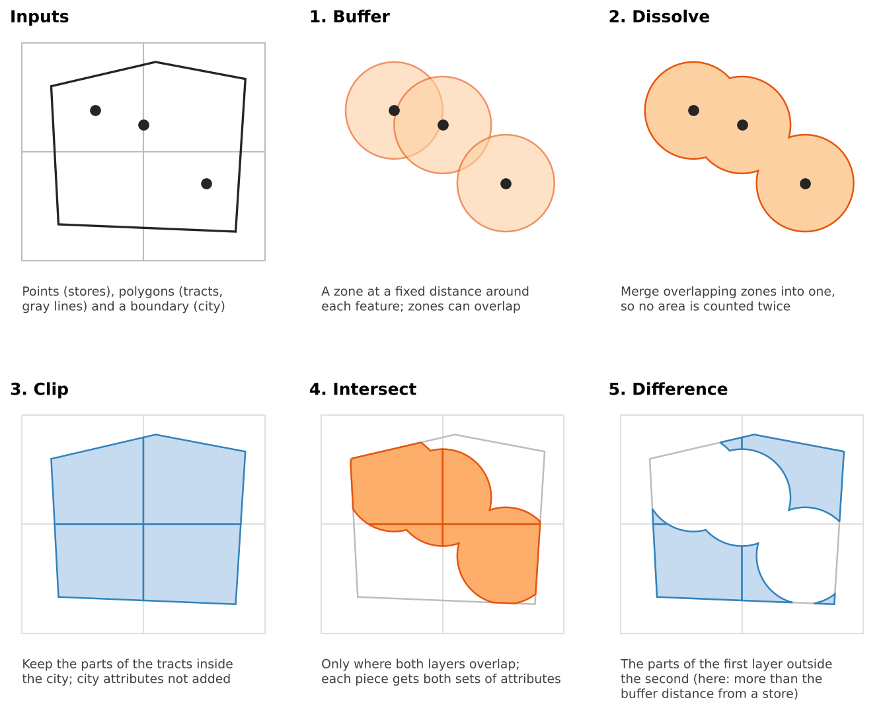
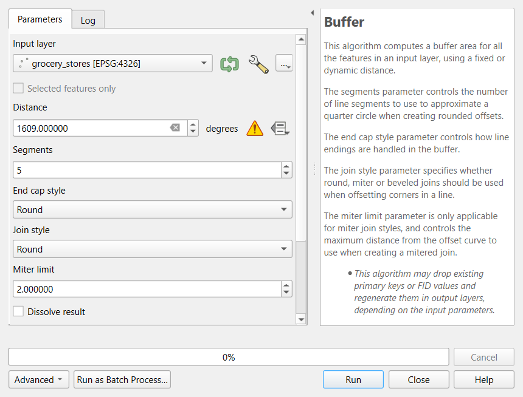
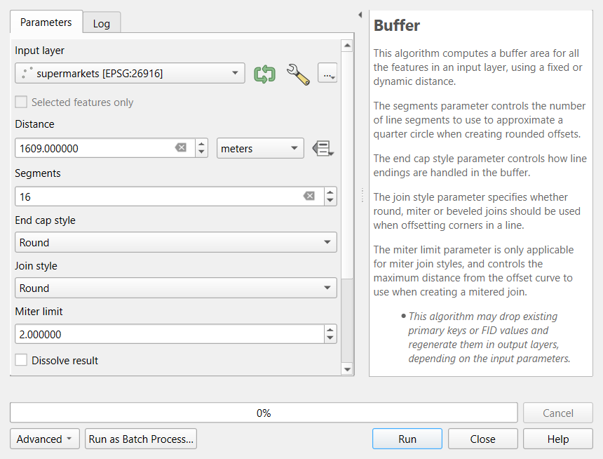
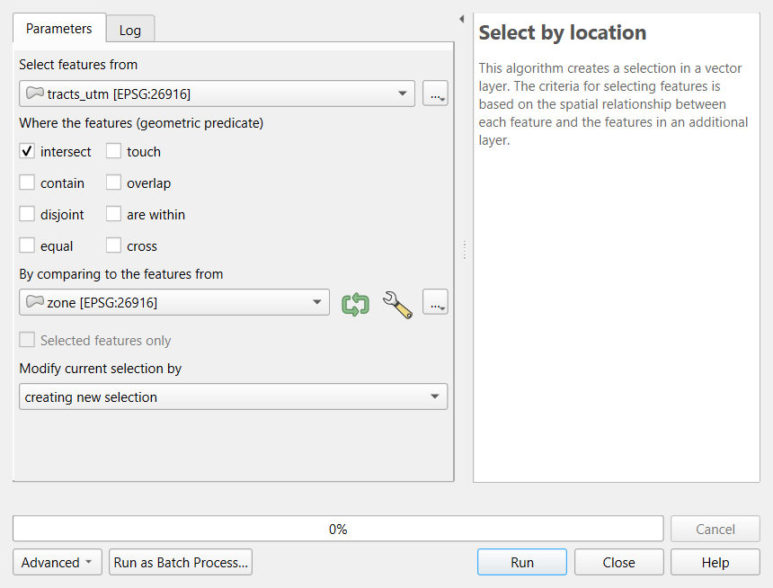
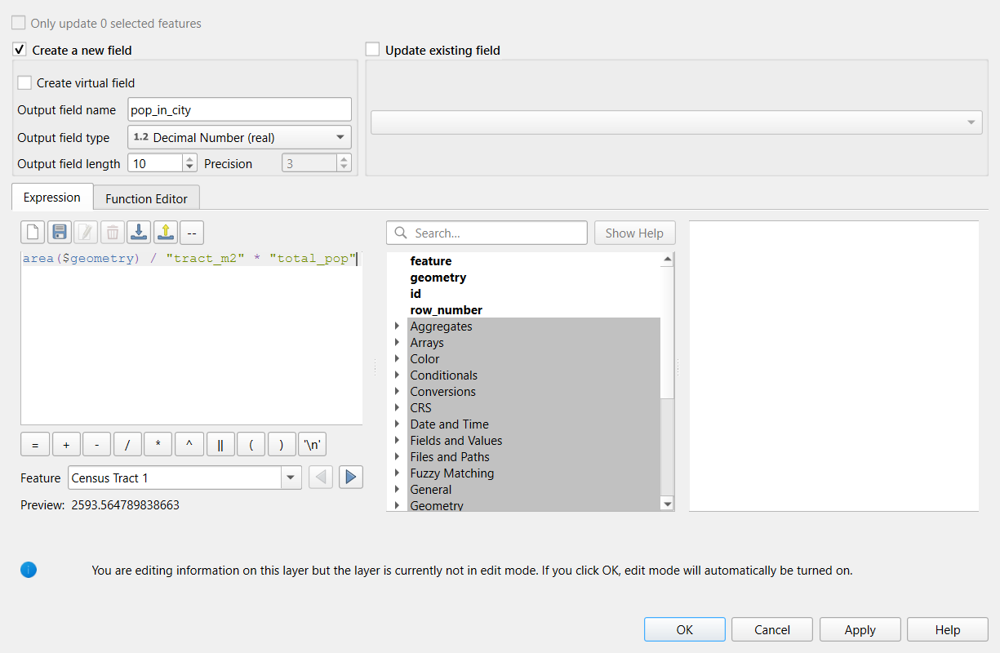
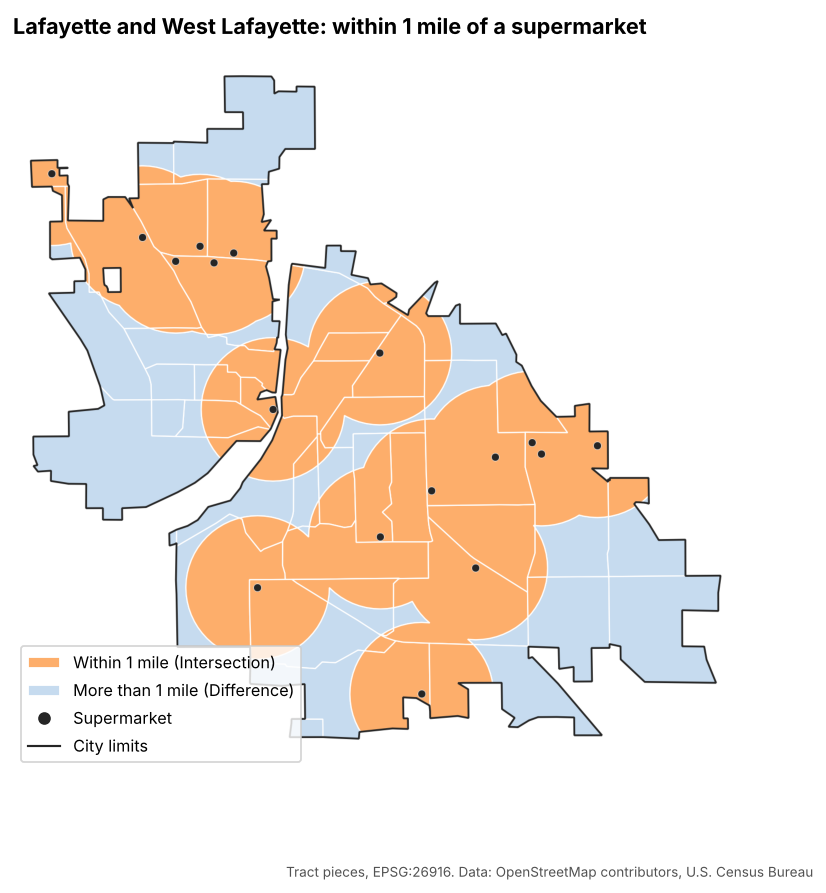
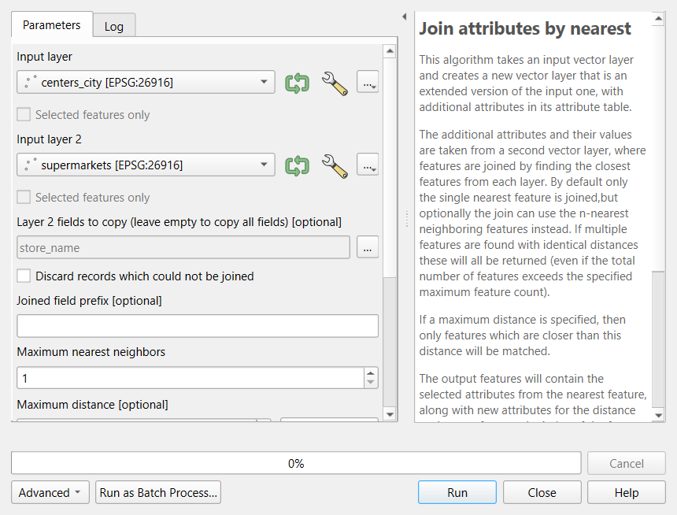

:::::::::::::::::::::::::::::::::::::: questions

- What are the everyday geoprocessing operations, and what does each one produce?
- Why must a layer be projected before buffering or measuring?
- How do I estimate how many people live in a zone that cuts across census tracts?
- Where are these tools in QGIS?

::::::::::::::::::::::::::::::::::::::::::::::::

::::::::::::::::::::::::::::::::::::: objectives

- Explain buffer, dissolve, clip, intersect, difference and nearest join, and choose the right one
- Reproject layers to a CRS in meters and run each operation from the Vector menu and the Processing Toolbox
- Select features by location and explain how the choice of spatial predicate changes the answer
- Estimate a population inside a zone with areal weighting in the Field Calculator, and state its assumption
- Measure straight-line distances to the nearest facility and recognize their limits

::::::::::::::::::::::::::::::::::::::::::::::::

## What is geoprocessing?

**Geoprocessing** means operations that take one or more spatial layers and produce a new layer: a zone around
every store, the parts of tracts inside a city, the distance from each neighborhood to its nearest clinic. A
small set of operations covers most everyday GIS work, and every GIS program (QGIS, ArcGIS Pro, GeoPandas, R's
`sf`) offers the same ones under similar names.

This episode answers one question with them: **how many people in Lafayette and West Lafayette live within
1 mile of a supermarket?** The [Geoprocessing in Python](geoprocessing-python.md) episode answers the same
question with the same data in code, so you can compare results.

{alt="Six small diagrams. Inputs: three store points, four square tracts drawn with gray lines and a city boundary outline. 1. Buffer: an orange circle around each point; the circles overlap. 2. Dissolve: the circles merged into one orange shape with no inner lines. 3. Clip: the four tracts cut to the city outline, shaded blue. 4. Intersect: only the parts of the clipped tracts that fall inside the merged circles, shaded orange, still split along tract lines. 5. Difference: the parts of the clipped tracts outside the circles, shaded blue."}

## The operations

| Operation | Question it answers | Output | QGIS |
|---|---|---|---|
| **Buffer** | What is within *d* meters of each feature? | One polygon per feature | **Vector > Geoprocessing Tools > Buffer** |
| **Dissolve** | What is the combined area, or the total per group? | Merged features | **Vector > Geoprocessing Tools > Dissolve** |
| **Select by location** | Which features touch, contain or lie within another layer? | A selection (no new shapes) | **Vector > Research Tools > Select by Location** |
| **Clip** | What part of this layer lies inside a boundary? | Cut shapes, own attributes only | **Vector > Geoprocessing Tools > Clip** |
| **Intersect** | Where do two layers overlap? | Cut shapes, attributes of both | **Vector > Geoprocessing Tools > Intersection** |
| **Difference** | What part of A lies outside B? | Cut shapes of A | **Vector > Geoprocessing Tools > Difference** |
| **Nearest join** | What is the closest feature, and how far is it? | Each feature plus the nearest match and a distance | Processing Toolbox: **Join attributes by nearest** |

Two habits make the difference between a result you can trust and one you cannot:

- **Clip versus intersect.** Both cut shapes. Clip only uses the second layer as a cookie cutter; intersect also
  copies its attributes onto every piece. Use intersect when you need to know *which* zone each piece is in.
- **Keep the original area.** Once a tract is cut, you can no longer tell what share of it remains. Store its
  area in a field *before* any clip or intersect.

## Projection comes first

A buffer distance and a measured area are in the units of the layer's coordinate reference system (CRS). Data
from the web usually arrives in **EPSG:4326**, latitude and longitude in degrees. The Buffer dialog says so:
next to the distance it shows **degrees** and a yellow warning sign, and a distance of 1609 would be read as
1,609 *degrees*. A small value such as 0.015 looks plausible but is still wrong: in Indiana a degree of longitude
is about 85 km and a degree of latitude about 111 km, so the "circle" is an ellipse.

{alt="Screenshot of the QGIS Buffer tool with the grocery_stores layer in EPSG:4326 as input. The distance box reads 1609 and the unit next to it says degrees, followed by a yellow triangle warning icon. Its tooltip reads: Distance is in geographic degrees. Consider reprojecting to a projected local coordinate system for accurate results."}

QGIS reprojects layers **on the fly** so they line up on screen, but the tools work on each layer's own
coordinates. So convert every layer you will analyze to a **projected** CRS in meters first, with
**Reproject Layer**. For Indiana, **EPSG:26916** (UTM zone 16N) is the usual choice for local work. The
Foundations [QGIS episode](https://spatialturn.github.io/Foundations/qgisintro.html) and the Data Management
module's [Coordinate Reference Systems](https://spatialturn.github.io/DataManagement/crs.html) episode cover
the theory.

::::::::::::::::::::::::::::::::::::: callout

## `$area` or `area($geometry)`?

The Field Calculator offers two ways to measure. `$area` measures on the ellipsoid set in **Project >
Properties > General**, in the units chosen there. `area($geometry)` measures in the layer's own CRS units. In a
layer reprojected to EPSG:26916 the two agree closely; in a layer still in degrees `area($geometry)` returns
square degrees. This episode uses `area($geometry)` so the numbers match the Python version exactly.

::::::::::::::::::::::::::::::::::::::::::::::::

## Choosing a distance

A buffer is only as meaningful as its distance. Common thresholds in access research:

| Distance | Roughly | Typical use |
|---|---|---|
| 400 m (a quarter mile) | 5-minute walk | Bus stops, small parks |
| 800 m (a half mile) | 10-minute walk | Parks, transit stations, corner stores |
| 1.6 km (1 mile) | 20-minute walk | Supermarkets in urban areas (the USDA's urban threshold) |
| 16 km (10 miles) | Short drive | Supermarkets in rural areas (the USDA's rural threshold) |

Choose the distance from the literature or from a policy you are evaluating, write it down, and test whether
your conclusion changes with a smaller or larger value. That last step is a **sensitivity analysis**, and in
QGIS it means rerunning one tool with a different number (the **Graphical Modeler** can chain the steps so you
rerun them all at once).

## Selecting by location

Select by Location selects the features of one layer that pass a **spatial predicate** against another:

| Predicate (QGIS wording) | True when |
|---|---|
| **intersect** | The shapes share any point (touching counts) |
| **are within** | The feature is completely inside the other shape |
| **contain** | The other shape is completely inside the feature |
| centroid **are within** | The feature's center point is inside the other shape (run **Centroids** first) |

The predicate changes the answer, sometimes dramatically. With the 1-mile supermarket zone in Lafayette,
**35** tracts intersect it, only **6** lie completely within it, and **24** have their center inside it. None of
these is wrong, but a report that says "24 tracts are near a supermarket" must say which test produced that
number.

## From areas to people: areal weighting

Tracts do not line up with buffers or city limits, so a tract is often split. If 40% of a tract's area falls in
the 1-mile zone, how many of its residents live there? **Areal weighting** assumes they are spread evenly, so it
assigns 40% of the population:

estimated people in a piece = tract population × (piece area ÷ tract area)

It is simple and transparent, and it is wrong in a predictable way: people live in houses, not in fields,
parks, rivers or parking lots. Areal weighting **overestimates** people in empty parts of a tract and
**underestimates** them in dense parts. Better methods use smaller units (block groups, blocks) or land cover,
a technique called **dasymetric mapping**; the Raster Analysis episode shows how to summarize land cover by
tract, which is the first step.

## Counts, rates and dissolving

**Dissolve** merges features. In current QGIS versions the plain Dissolve tool keeps the attributes of one
feature and does **not** add up numbers. To merge and total at the same time, use **Aggregate** in the
Processing Toolbox (or sum in the attribute table, as this episode does). Summing is right for **counts**
(people, households, households without a car) and wrong for **rates and medians** (poverty rate, median
income). For a rate, sum the numerator and the denominator separately and divide.

## Pitfalls

- **Edge effects.** The store layer covers only the two cities. A rural tract near the county line may have a
  supermarket just outside the data, so this episode limits the analysis to the city limits.
- **Straight line is not travel.** Rivers, railroads and highways turn a 1-mile straight line into a much
  longer trip. Grocery Access Part 2 in the Case Studies module measures along roads with QGIS network tools.
- **Centroids are not people.** A tract center can fall in a field. Population-weighted centers or smaller
  units give fairer distances.
- **Temporary layers.** Processing results are **temporary scratch layers** (a small chip icon in the Layers
  panel) and vanish when QGIS closes. Right-click and choose **Make Permanent** for anything you want to keep.
- **Data currency.** OpenStreetMap stores open and close. Check the data against local knowledge.

---

## Hands-on: supermarkets within 1 mile

These steps were checked in QGIS 4.0; in QGIS 3.34 and later the menus are the same. Keep the **Processing
Toolbox** open (**Processing > Toolbox**): its search box finds any tool by name.

### Part 1: Load the layers from the web

Use **Layer > Add Layer > Add Vector Layer**, **Source Type: Protocol: HTTP(S), cloud, etc.**, **Type:
HTTP/HTTPS/FTP** (in QGIS 4 the Type list starts with cloud services, so check it), as in the Foundations QGIS
episode, and add these three addresses:

| Layer | Web address |
|---|---|
| Grocery stores | `https://raw.githubusercontent.com/SpatialTurn/CaseStudies/main/data/grocery_stores.geojson` |
| City limits | `https://raw.githubusercontent.com/SpatialTurn/CaseStudies/main/data/study_area.geojson` |
| Tracts with ACS data | `https://raw.githubusercontent.com/SpatialTurn/Foundations/main/data/tippecanoe_tracts_acs.geojson` |

The tracts layer already has the 2024 ACS columns joined (`total_pop`, `pop_under18`, `households`,
`hh_no_vehicle` and others); the Foundations episode on tables shows how that join is done. Add an
OpenStreetMap basemap underneath if you like.

**Check:** 64 store points and one city polygon over Lafayette, 43 tracts covering Tippecanoe County.

### Part 2: Reproject to meters

1. Open **Vector > Data Management Tools > Reproject Layer** (or search the Processing Toolbox for it).
2. **Input layer:** `grocery_stores`. **Target CRS:** click the globe button and choose **EPSG:26916 - NAD83 /
   UTM zone 16N**. Leave **Reprojected** as a temporary layer and click **Run**.
3. Rename the result `stores_utm` (right-click > **Rename Layer**).
4. Repeat for the city limits (`city_utm`) and the tracts (`tracts_utm`). The dialog remembers the CRS.
5. Set the project CRS to EPSG:26916 as well (click the CRS button at the bottom right of the window).

**Check:** right-click `tracts_utm` > **Properties > Information**: the CRS is EPSG:26916 and the units are
meters.

### Part 3: Keep only the supermarkets

1. Processing Toolbox: **Extract by attribute**.
2. **Input layer:** `stores_utm`; **Selection attribute:** `store_type`; **Operator:** `=`; **Value:**
   `Supermarket`. Run, and rename the result `supermarkets`.

**Check:** 17 features (open the attribute table, or look at the count after the layer name with
**Show Feature Count**).

### Part 4: Buffer, then dissolve

1. **Vector > Geoprocessing Tools > Buffer**.
2. **Input layer:** `supermarkets`. **Distance:** `1609`, **meters**. **Segments:** `16` (smoother circles; the
   Python version uses the same). Leave **Dissolve result** unchecked for now. Run, and name the result
   `buffers`.

   {alt="Screenshot of the QGIS Buffer tool. Input layer is supermarkets in EPSG:26916, Distance is 1609 meters, Segments is 16, End cap style and Join style are Round, Miter limit is 2, and Dissolve result is unchecked. The help panel on the right explains the segments, end cap and join style parameters."}
3. Open the attribute table of `buffers`, click the **Field Calculator** (the abacus icon), and create a new
   **decimal** field `km2` with the expression `area($geometry) / 1000000`. Click **OK**, then the pencil icon
   to stop editing and save.
4. Select all rows and look at the **Statistics** panel (**View > Panels > Statistics**), choosing the `km2`
   field: the **Sum** is about **138 km²**.
5. Now run **Vector > Geoprocessing Tools > Dissolve** on `buffers` (no dissolve field). Name it `zone` and
   measure it the same way: about **85 km²**.

The difference, 53 km², is overlap that would have been counted twice. (The Buffer tool's own **Dissolve
result** box does both steps at once.)

### Part 5: Select by location

1. **Vector > Research Tools > Select by Location**.
2. **Select features from:** `tracts_utm`; **where the features:** tick **intersect**; **By comparing to the
   features from:** `zone`. Click **Run**, then **Close**.

   {alt="Screenshot of the QGIS Select by Location tool. Select features from is tracts_utm, the geometric predicate intersect is ticked and the others (contain, disjoint, equal, touch, overlap, are within, cross) are not, By comparing to the features from is zone, and Modify current selection by is creating new selection."}
3. The status bar and the layer's attribute table show **35** selected tracts.
4. Run it again with only **are within** ticked: **6** tracts.
5. For the centroid test, run **Vector > Geometry Tools > Centroids** on `tracts_utm` (name it `centers`),
   then select `centers` that **are within** `zone`: **24** points.

Clear selections with **Edit > Select > Deselect Features from All Layers** before moving on.

### Part 6: Store each tract's original area

1. Open the attribute table of `tracts_utm` and the **Field Calculator**.
2. New field `tract_m2`, type **Decimal Number (real)**, expression `area($geometry)`. **OK**, then stop
   editing and save.

This must happen **before** clipping, because the clipped pieces will copy this field unchanged.

### Part 7: Clip to the city and estimate its population

1. **Vector > Geoprocessing Tools > Clip**: **Input layer** `tracts_utm`, **Overlay layer** `city_utm`. Name the
   result `tracts_city`.
2. **Check:** 39 features. Many are only parts of tracts.
3. In its Field Calculator, create `pop_in_city` (**Decimal Number (real)**) with
   `area($geometry) / "tract_m2" * "total_pop"`. The **Preview** under the expression shows the result for the
   first tract, a quick check that the expression works.

   {alt="Screenshot of the QGIS Field Calculator for the tracts_city layer. Create a new field is checked, Output field name is pop_in_city, Output field type is Decimal Number (real) with length 10 and precision 3. The expression box contains area($geometry) divided by tract_m2 times total_pop, and the preview for Census Tract 1 reads 2593.56. A note at the bottom says edit mode will be turned on automatically when OK is clicked."}
4. In the Statistics panel, the sum of `pop_in_city` is about **114,000**. The 2020 Census counted about 115,000
   people in the two cities, so areal weighting comes close here.

### Part 8: Intersect with the 1-mile zone

1. **Vector > Geoprocessing Tools > Intersection**: **Input layer** `tracts_city`, **Overlay layer** `zone`.
   Name it `near_pieces`.
2. Field Calculator: `pop_near` = `area($geometry) / "tract_m2" * "total_pop"`.
3. The sum of `pop_near` is about **77,500**, or **68%** of the city estimate.

The pieces also carry the attributes of the zone. Because the zone was dissolved from 17 buffers, those
columns (`store_name`, `address` and so on) describe just one store and mean nothing here; ignore or delete
them. This is the practical difference between Intersection and Clip.

### Part 9: The parts farther than 1 mile

1. **Vector > Geoprocessing Tools > Difference**: **Input layer** `tracts_city`, **Overlay layer** `zone`. Name
   it `far_pieces`.
2. In both `near_pieces` and `far_pieces`, create `nocar_est` =
   `area($geometry) / "tract_m2" * "hh_no_vehicle"`.
3. Compare the sums: about **4,570** households without a car live within 1 mile of a supermarket and about
   **1,450** live farther away.

{alt="Map of Lafayette and West Lafayette titled within 1 mile of a supermarket. The city area is split along census tract lines into orange pieces within 1 mile of one of 17 supermarkets (black dots) and light blue pieces farther away. Most of the central and eastern city is orange; the light blue areas are along the northern, western and southeastern edges of the city and in a band along the river."}

::::::::::::::::::::::::::::::::::::: callout

## Small differences from the Python version

Your sums may differ from the Python notebooks in the last digit or two. Buffers are polygons that only
approximate circles, and QGIS and GeoPandas place the segment points slightly differently. Differences of a few
people are normal; differences of thousands mean a step went wrong (most often a layer still in degrees).

::::::::::::::::::::::::::::::::::::::::::::::::

### Part 10: Distance to the nearest supermarket

1. Select the `centers` that **are within** `city_utm` (Select by Location), then right-click `centers` >
   **Export > Save Selected Features As** (or use **Extract by location**) to make `centers_city`: **31** points.
2. Processing Toolbox: **Join attributes by nearest**. **Input layer** `centers_city`, **Input layer 2**
   `supermarkets`, **Layer 2 fields to copy** `store_name`, **Maximum nearest neighbors** `1`. Run.

   {alt="Screenshot of the QGIS Join attributes by nearest tool. Input layer is centers_city, Input layer 2 is supermarkets, Layer 2 fields to copy is store_name, Discard records which could not be joined is unchecked, Joined field prefix is empty and Maximum nearest neighbors is 1. The help panel explains that attributes are taken from the closest feature in the second layer."}
3. Open the result's attribute table and sort the `distance` field (in meters, the layer CRS units) from high
   to low. Census Tract 102.07 is farthest, about **3,820 m** from a supermarket; the median is about
   **1,250 m**.
4. Style the points with **Graduated** symbology on `distance` to see the pattern.

---

:::::::::::::::::::::::::::::::::::: challenge

## Challenge 1: Which operation?

Name the operation (or operations) for each task.

1. Show the parts of Tippecanoe County that are within 500 m of the Wabash River.
2. Count the households in each tract that live within 500 m of the river.
3. Keep only the bus stops that lie inside the West Lafayette city limits.
4. Find the closest library to each school, and how far away it is.

:::::::::::::::: solution

1. **Buffer** the river by 500 m (reprojected first), with **Dissolve result** ticked if it is made of several
   segments.
2. Store each tract's area, **Intersection** of the tracts with the buffer, then **areal weighting** in the
   Field Calculator on the households field.
3. **Select by Location** with **are within** (or **Extract by location** to save them as a layer).
4. **Join attributes by nearest**, which adds a `distance` field.

:::::::::::::::::::::::::

::::::::::::::::::::::::::::::::::::::::::::::::

:::::::::::::::::::::::::::::::::::: challenge

## Challenge 2: A half-mile walk

Repeat Parts 4 and 5 with a **half-mile (805 m)** buffer, closer to a 10-minute walk. How many tract centers
fall inside the half-mile zone? What does this tell you about walking to a supermarket in Lafayette?

:::::::::::::::: solution

Buffer `supermarkets` by `805` m with **Dissolve result** ticked, then select `centers` that **are within** the
new zone: **6** tract centers (compared with 24 for 1 mile). Most neighborhoods are not within an easy
10-minute walk of a supermarket, so the result depends strongly on the threshold. This is why the distance
should be justified and tested.

:::::::::::::::::::::::::

::::::::::::::::::::::::::::::::::::::::::::::::

:::::::::::::::::::::::::::::::::::: challenge

## Challenge 3: Is the estimate too high or too low?

Census Tract 104 contains most of Purdue's residence halls and also large areas of lawns and playing fields.
Half of the tract's area lies inside a park's 800 m buffer, and the buffered half is mostly playing fields.
Will areal weighting overestimate or underestimate the residents near the park? What would improve the
estimate?

:::::::::::::::: solution

It will **overestimate**: areal weighting puts half the residents in the buffered half, but few people live on
the playing fields. Better estimates use smaller units (census blocks), or land cover to move people onto
developed land (dasymetric mapping, previewed in the Raster Analysis episode). At minimum, report the
assumption and check the tract against a basemap.

:::::::::::::::::::::::::

::::::::::::::::::::::::::::::::::::::::::::::::

::::::::::::::::::::::::::::::::::::: keypoints

- Reproject every layer to a CRS in meters (EPSG:26916 for Indiana) before buffering, measuring or overlaying;
  on-the-fly display does not change the data
- Buffer draws zones, Dissolve merges them, Clip and Intersection cut shapes, Difference keeps what lies outside,
  and Join attributes by nearest finds the closest feature and its distance
- The predicate in Select by Location (intersect, are within, centroid within) changes the answer; report it
- Store the original area before cutting, then use `area($geometry) / "tract_m2" * count` for areal weighting
- Sum counts, never rates or medians; processing results are temporary until you make them permanent

::::::::::::::::::::::::::::::::::::::::::::::::
