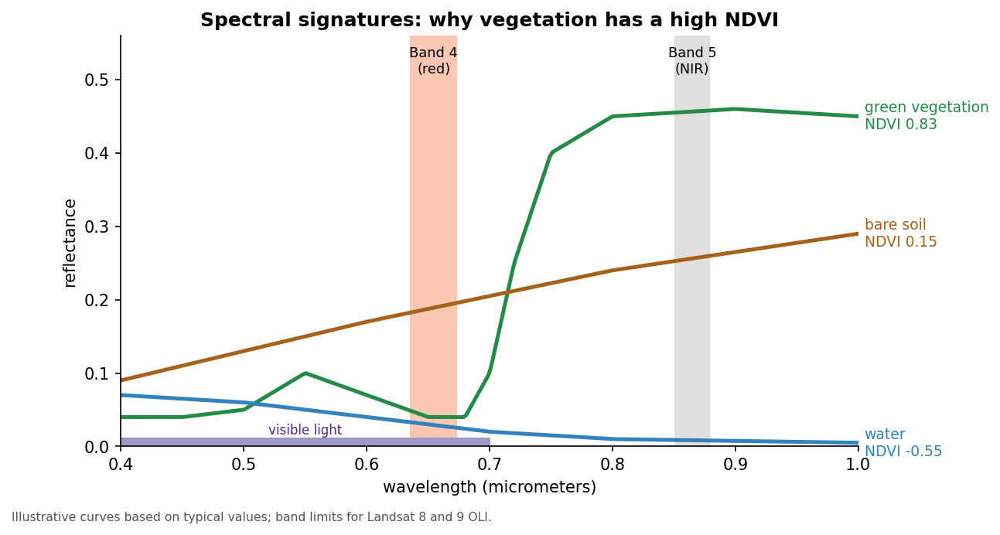

:::::::::::::::::::::::::::::::::::::: questions

- What is NDVI and why is it useful?
- How do we read Landsat bands and compute NDVI in Python?
- How can we classify NDVI into land cover groups?
- What affects NDVI values, and how should they be interpreted?

::::::::::::::::::::::::::::::::::::::::::::::::

::::::::::::::::::::::::::::::::::::: objectives

- Explain why vegetation is bright in near infrared and dark in red
- Read raster bands with `rasterio` and convert them to surface reflectance
- Compute, map and save NDVI as a GeoTIFF
- Classify NDVI with thresholds and summarize area by class
- Describe spectral signatures, image processing levels and resolution
- Recognize the limits of NDVI (season, clouds, saturation, mixed pixels) when comparing places and dates

::::::::::::::::::::::::::::::::::::::::::::::::

## Why NDVI?

Healthy leaves absorb red light for photosynthesis and strongly reflect near infrared (NIR) light.
The **Normalized Difference Vegetation Index (NDVI)** uses that contrast to measure greenness
from satellite images. It is easy to compute, works with most sensors (Landsat, Sentinel-2, MODIS),
and is used for crop monitoring, drought, urban green space and land cover change.

| NDVI | Typical surface |
|---|---|
| below 0 | Water, snow, clouds |
| 0 to 0.2 | Bare soil, buildings, roads |
| 0.2 to 0.4 | Sparse vegetation, grass, early crops |
| above 0.4 | Dense, healthy vegetation |

The notebooks use one Landsat scene over Indiana (Collection 2 Level-2 surface reflectance).
For Landsat 8 and 9, **Band 4 is red** and **Band 5 is NIR**.

## How satellites see vegetation

A satellite sensor measures how much sunlight each patch of ground reflects in several **bands**, narrow
ranges of wavelength. The share of light reflected is the **reflectance**, from 0 (all absorbed) to 1 (all
reflected). Each kind of surface has a typical pattern of reflectance across wavelengths, its **spectral
signature**.

{alt="Line chart of reflectance (0 to 0.5) against wavelength (0.4 to 1.0 micrometers), with illustrative curves. Green vegetation is low in blue and red, with a small bump in green, then rises steeply after about 0.7 micrometers to about 0.45 in the near infrared. Bare soil rises gently from about 0.1 to 0.3. Water is low everywhere and falls to almost 0 in the near infrared. Two shaded bands mark Landsat 8 and 9 Band 4 (red, about 0.64 to 0.67 micrometers) and Band 5 (near infrared, about 0.85 to 0.88 micrometers). Labels give the resulting NDVI: vegetation 0.83, soil 0.15, water minus 0.55."}

- **Healthy vegetation** absorbs most red and blue light, because chlorophyll uses it for photosynthesis, and
  reflects a little more green, which is why leaves look green. In the near infrared, just beyond what our
  eyes can see, the internal structure of leaves scatters light strongly, so reflectance jumps to 0.3 to 0.5.
- **Bare soil and pavement** reflect a moderate amount, rising gently with wavelength, so red and NIR are
  similar.
- **Water** absorbs nearly all NIR light, so it is dark in that band.

NDVI uses the steep rise between red and NIR (the **red edge**) that only vegetation shows.

## Why a normalized difference?

The plain difference, NIR minus red, already separates vegetation from other surfaces, but it also changes
with the brightness of the scene: the sun angle, slopes facing toward or away from the sun, and thin haze.
Dividing by NIR plus red cancels much of that brightness effect and keeps every value between -1 and +1, so
NDVI from different places and dates is easier to compare.

## From pixels to reflectance

Landsat images are distributed at different **processing levels**:

| Product | What the values are | Use |
|---|---|---|
| Level-1 | Digital numbers (DN): calibrated sensor counts, still affected by the atmosphere | Needs conversion before indices are compared |
| Level-2 surface reflectance | Reflectance corrected for the atmosphere, stored as integers | Ready for NDVI after applying the scale and offset |

Collection 2 Level-2 values are stored as integers to save space; multiplying by 0.0000275 and adding -0.2
turns them back into reflectance. The value 0 marks pixels outside the scene. Level-2 products also include a
`QA_PIXEL` band that flags clouds, cloud shadows, snow and water. Masking the flagged pixels before analysis
stops a cloud from being counted as bare ground.

**Resolution** describes how much detail an image holds:

| | Landsat 8 and 9 | Sentinel-2 |
|---|---|---|
| Pixel size (red and NIR) | 30 m | 10 m |
| Red and NIR bands | Bands 4 and 5 | Bands 4 and 8 |
| Revisit | 16 days per satellite, 8 days with both | About 5 days with both satellites |
| Archive | Landsat images since 1972 (this sensor design since 2013) | Since 2015 |

:::::::::::::::::::::::::::::::::::::::::::::::::::::::::::::::::::: instructor

Pause after the formula and make sure learners know which band is which. Each band is about 90 MB and
is read from GitHub into memory, so the reading cell takes a few seconds.

::::::::::::::::::::::::::::::::::::::::::::::::::::::::::::::::::::::::::::::::

## 1. Read the bands and convert to reflectance

```python
import numpy as np
import matplotlib.pyplot as plt
import rasterio

# rasterio reads the bands straight from GitHub into memory; nothing is downloaded
LANDSAT = "https://raw.githubusercontent.com/SpatialTurn/DataAnalysis/main/data/landsat"

with rasterio.open(f"{LANDSAT}/band4.TIF") as src:     # red
    red = src.read(1).astype("float32")
    profile = src.profile
with rasterio.open(f"{LANDSAT}/band5.TIF") as src:     # near infrared
    nir = src.read(1).astype("float32")

red[red == 0] = np.nan          # 0 = outside the scene
nir[nir == 0] = np.nan

# Level-2 values are stored as integers; this converts them to reflectance (0 to 1)
red = np.clip(red * 0.0000275 - 0.2, 0, 1)
nir = np.clip(nir * 0.0000275 - 0.2, 0, 1)
```

## 2. Compute and map NDVI

```python
ndvi = (nir - red) / (nir + red)

plt.imshow(ndvi, cmap="RdYlGn", vmin=-0.2, vmax=0.8)
plt.colorbar(label="NDVI")
plt.title("NDVI, Landsat scene over Indiana")
plt.show()
```

## 3. Save NDVI as a GeoTIFF (optional)

```python
profile.update(dtype="float32", count=1, nodata=np.nan)
with rasterio.open("ndvi.tif", "w", **profile) as dst:
    dst.write(ndvi.astype("float32"), 1)
```

Everything above stays in memory. Save a file only if you want to open the result in QGIS;
it keeps the scene's location, so it lines up exactly.

## 4. Classify NDVI

`np.digitize` gives each pixel a class number. **Three** break values make **four** classes,
so we need four colors.

```python
from matplotlib.colors import ListedColormap

classes = np.digitize(ndvi, [0, 0.2, 0.4]).astype("float32")   # 0, 1, 2, 3
classes[np.isnan(ndvi)] = np.nan

colors = ["#2b83ba", "#d7a26b", "#a6d96a", "#1a9641"]   # water, bare, sparse, dense
plt.imshow(classes[::4, ::4], cmap=ListedColormap(colors), vmin=0, vmax=3,
           interpolation="nearest")    # every 4th pixel keeps the plot fast
plt.title("NDVI classes")
plt.show()
```

:::::::::::::::::::::::::::::::::::: challenge

## Challenge 1: Five classes

Classify NDVI into five classes with breaks `[0, 0.1, 0.2, 0.3]`. How many colors do you need?

:::::::::::::::::::::::: solution

Four breaks make five classes, so you need five colors and `vmax=4`.

```python
classes = np.digitize(ndvi, [0, 0.1, 0.2, 0.3]).astype("float32")
classes[np.isnan(ndvi)] = np.nan
colors = ["#2b83ba", "#d7a26b", "#fdae61", "#a6d96a", "#1a9641"]
plt.imshow(classes[::4, ::4], cmap=ListedColormap(colors), vmin=0, vmax=4,
           interpolation="nearest")
plt.show()
```

:::::::::::::::::::::::::::::::::
::::::::::::::::::::::::::::::::::::::::::::::::

:::::::::::::::::::::::::::::::::::: challenge

## Challenge 2: Mask water

Replace NDVI values below 0 with `np.nan` and map the result. What is the mean NDVI of land only?

:::::::::::::::::::::::: solution

```python
ndvi_land = np.where(ndvi < 0, np.nan, ndvi)
plt.imshow(ndvi_land[::4, ::4], cmap="YlGn", vmin=0, vmax=0.8)
plt.show()
print(np.nanmean(ndvi_land))
```

Masked pixels are left blank on the map and ignored by `np.nanmean`.

:::::::::::::::::::::::::::::::::
::::::::::::::::::::::::::::::::::::::::::::::::

## Interpreting NDVI carefully

- **Thresholds depend on place and season.** The table at the top is a rule of thumb. A dry grassland in
  August and a corn field in July can differ widely. Check thresholds against a true color image or a field
  visit.
- **Saturation.** In dense forest and crops, NDVI levels off around 0.8 to 0.9 and stops responding to
  further increases in leaf area.
- **Soil background.** Where vegetation is sparse, the soil underneath strongly affects NDVI. The Soil
  Adjusted Vegetation Index (SAVI) and the Enhanced Vegetation Index (EVI) were designed to reduce soil and
  atmospheric effects.
- **Mixed pixels.** A 30 m pixel in a city can contain a tree, a roof and a road. Its NDVI is a blend, so small
  green spaces such as street trees and yards are underestimated.
- **Clouds and shadows** lower NDVI and can be mistaken for bare ground or water.

## Comparing dates: change detection

Subtracting NDVI from two dates (for example `ndvi_2024 - ndvi_2014`) maps where vegetation was gained or
lost. Use scenes from the **same time of year**, because crops and trees change through the seasons (their
**phenology**), and use the same processing level, ideally from the same or a cross-calibrated sensor. Small
differences of a few hundredths are within the noise; look for large, coherent changes.

## From thresholds to classification

Thresholding NDVI (Section 4) is the simplest way to classify land cover. Notebook 6c goes further:

- **Unsupervised classification** (K-Means) groups pixels with similar values across several bands; you
  name the groups afterwards.
- **Supervised classification** (Random Forest) learns from training samples you label, such as polygons
  of known forest, water and buildings, and then predicts every pixel. It needs good training data and an
  **accuracy assessment**: compare the predictions with reference points that were not used for training,
  and summarize the agreement in a confusion matrix.

:::::::::::::::::::::::::::::::::::: challenge

## Challenge 3: NDVI by hand

Compute NDVI for three pixels and say what each one probably is:

1. red = 0.08, NIR = 0.40
2. red = 0.20, NIR = 0.24
3. red = 0.06, NIR = 0.03

:::::::::::::::::::::::: solution

1. (0.40 - 0.08) / (0.40 + 0.08) = 0.32 / 0.48 = **0.67**: dense, healthy vegetation
2. (0.24 - 0.20) / (0.24 + 0.20) = 0.04 / 0.44 = **0.09**: bare soil, a road or a roof
3. (0.03 - 0.06) / (0.03 + 0.06) = -0.03 / 0.09 = **-0.33**: water

:::::::::::::::::::::::::::::::::
::::::::::::::::::::::::::::::::::::::::::::::::

::::::::::::::::::::::::::::::::::::: callout

NDVI changes with the seasons, clouds and the atmosphere. Compare scenes from the same time of
year, and use surface reflectance (Level-2) products rather than raw Level-1 values when possible.

::::::::::::::::::::::::::::::::::::::::::::::::

## Math

$$
NDVI = \frac{NIR - Red}{NIR + Red}
$$

NDVI ranges from -1 to +1. Healthy vegetation has high NIR and low red reflectance, which pushes NDVI
toward +1. Water reflects more red than NIR, so its NDVI is negative.

::::::::::::::::::::::::::::::::::::: keypoints

- NDVI compares NIR and red reflectance; for Landsat 8 and 9 these are bands 5 and 4
- Convert Level-2 values to reflectance (`value * 0.0000275 - 0.2`) before computing NDVI
- `rasterio` reads and writes rasters; reuse the input `profile` when saving
- `np.digitize` turns NDVI into classes; n breaks give n + 1 classes
- Vegetation's spectral signature (low red, high NIR) is what NDVI measures; normalizing reduces
  brightness effects
- Interpret NDVI with care: thresholds vary, dense canopies saturate, pixels mix, and clouds and seasons
  change the values

::::::::::::::::::::::::::::::::::::::::::::::::

## Notebooks

| Level | Notebook | What you will do |
|---|---|---|
| Beginner | <a href="https://colab.research.google.com/github/SpatialTurn/DataAnalysis/blob/main/notebooks/04a_Computing_NDVI.ipynb" target="_blank">6a. Computing NDVI from Landsat</a> | Read bands, convert to reflectance, map NDVI and save a GeoTIFF |
| Intermediate | <a href="https://colab.research.google.com/github/SpatialTurn/DataAnalysis/blob/main/notebooks/04b_Classifying_NDVI.ipynb" target="_blank">6b. Classifying NDVI</a> | Group NDVI into classes, map them and measure area per class |
| Advanced | <a href="https://colab.research.google.com/github/SpatialTurn/DataAnalysis/blob/main/notebooks/04c_Image_Classification_Advanced.ipynb" target="_blank">6c. Image Classification with Machine Learning</a> | True color image, K-Means and Random Forest classification |
