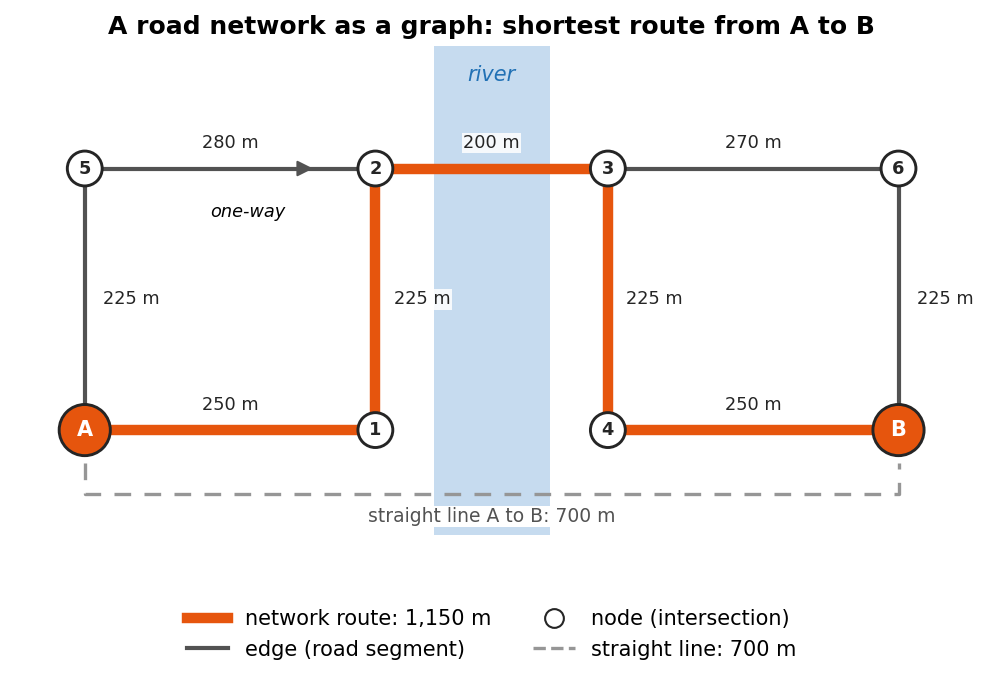

:::::::::::::::::::::::::::::::::::::: questions

- How can a road map be represented as a graph?
- How do we download and visualize road networks from OpenStreetMap?
- How do we find the shortest route and measure travel time?
- How do routes turn into measures of access, and what can go wrong?

::::::::::::::::::::::::::::::::::::::::::::::::

::::::::::::::::::::::::::::::::::::: objectives

- Explain nodes and edges in a road network
- Download a drivable network with OSMnx and inspect it as GeoDataFrames
- Compute shortest paths by distance and by travel time
- Measure travel time from many locations to one point, the basis of an access study
- Choose a network type and an access measure that fit the research question, and recognize the
  assumptions behind them

::::::::::::::::::::::::::::::::::::::::::::::::

## Why network analysis?

Straight line distance is misleading: a store 1 km away across a river may be a 6 km drive.
Network analysis measures distance **along roads**, which is how people actually travel.

Road networks are stored as **graphs**:

- **Nodes** are intersections and dead ends
- **Edges** are road segments, each with a length (and, once added, a speed and travel time)

Common uses include food and health care access, emergency response times, and transportation
planning.

{alt="Diagram of a small road network with eight intersections (nodes), the start A, the end B and six numbered ones, joined by road segments (edges), each labeled with its length in meters. A one-way street is drawn with an arrow. A dashed gray bracket under the network marks the straight-line distance from A to B, 700 meters. A thick orange line follows the edges from A to B along the shortest route, labeled network route, 1,150 meters, because a river with only one bridge forces a detour."}

## Thinking in graphs

A graph is a simple idea: a set of points (**nodes**) and the connections between them (**edges**). In a road
network, nodes are intersections and dead ends, and each edge is the stretch of road between two of them.
Everything else is stored as **attributes** of the edges:

| Edge attribute | Example | Used for |
|---|---|---|
| `length` | 212.4 (meters) | Shortest path by distance |
| `highway` | `residential`, `primary` | Road type, and a default speed |
| `maxspeed` | `30 mph` | Travel time, where speed limits are mapped |
| `oneway` | `True` | Which directions can be traveled |
| `travel_time` | 18.3 (seconds) | Fastest path, once added |

Three details matter for analysis:

- **Direction.** Streets can be one-way, so OSMnx stores roads as a **directed** graph: a two-way street is
  two edges, one in each direction. The route from A to B can therefore differ from the route from B to A.
- **Weights.** The "shortest" path depends on what each edge costs. With `length` as the weight you get the
  shortest route; with `travel_time` you get the fastest. You can also build your own weights, for example a
  walking cost that penalizes steep or busy roads.
- **Simplification.** OpenStreetMap draws a curving road with many small points. OSMnx removes the points that
  are not intersections, so each node is a real decision point and each edge keeps its full curved shape and
  length.

## Choosing the network type

The `network_type` argument decides which roads and paths are kept:

| `network_type` | Includes | Direction |
|---|---|---|
| `"drive"` | Public roads open to cars | One-way rules apply |
| `"walk"` | Streets and paths pedestrians can use, including footpaths where they are mapped; no motorways | Every edge can be walked both ways |
| `"bike"` | Streets and paths where cycling is allowed | One-way rules apply |

Pick the network that matches the people you study. A household without a car experiences the walking or
transit network, not the driving one, and the two can give very different answers about access.

::::::::::::::::::::::::::::::::::::: callout

## The same analysis in QGIS

The Case Studies module's [grocery access case study](https://spatialturn.github.io/CaseStudies/grocery-network.html) measures
shortest paths and service areas to supermarkets in Lafayette and West Lafayette with QGIS's network
tools, without writing code. Doing both is a good way to see what OSMnx does behind the scenes.

If you have not used OpenStreetMap tags before, the Data Collection module's
[Geocoding episode](https://spatialturn.github.io/DataCollection/geocoding.html) introduces them.

::::::::::::::::::::::::::::::::::::::::::::::::

:::::::::::::::::::::::::::::::::::::::::::::::::::::::::::::::::::: instructor

Draw a small graph on the board (four intersections, five roads) before showing any code.
Learners grasp `nearest_nodes` and `shortest_path` much faster once they can picture nodes and edges.
Note that `nearest_nodes` takes longitude first.

::::::::::::::::::::::::::::::::::::::::::::::::::::::::::::::::::::::::::::::::

## 1. Download a road network

```python
import osmnx as ox
import networkx as nx

G = ox.graph_from_place("West Lafayette, Indiana, USA", network_type="drive")
print(G.number_of_nodes(), "nodes,", G.number_of_edges(), "edges")
ox.plot_graph(G, node_size=5, edge_color="gray", bgcolor="white")
```

`network_type` can also be `"walk"` or `"bike"`. The graph is held in memory as `G`.

## 2. Look at nodes and edges as tables

```python
nodes, edges = ox.graph_to_gdfs(G)
edges[["name", "highway", "length"]].head()    # length is in meters
```

## 3. Add speeds and travel times

```python
G = ox.add_edge_speeds(G, fallback=40)   # km/h used where a road type has no speed data
G = ox.add_edge_travel_times(G)          # adds travel_time in seconds to every edge
```

## 4. Find the shortest route between two points

```python
start = ox.nearest_nodes(G, X=-86.9112, Y=40.4247)   # longitude, latitude
end = ox.nearest_nodes(G, X=-86.9290, Y=40.4580)

route = ox.shortest_path(G, start, end, weight="travel_time")
ox.plot_graph_route(G, route, route_color="red", node_size=0)
```

## 5. Measure the route

```python
route_edges = ox.routing.route_to_gdf(G, route)
print(round(route_edges["length"].sum() / 1000, 2), "km")
print(round(route_edges["travel_time"].sum() / 60, 1), "minutes")
```

:::::::::::::::::::::::::::::::::::: challenge

## Challenge 1: Shortest or fastest?

Compute the route between the same two points with `weight="length"` and with
`weight="travel_time"`. Are they the same route? Which is longer in kilometers?

:::::::::::::::::::::::: solution

```python
for w in ["length", "travel_time"]:
    e = ox.routing.route_to_gdf(G, ox.shortest_path(G, start, end, weight=w))
    print(w, round(e["length"].sum() / 1000, 2), "km",
          round(e["travel_time"].sum() / 60, 1), "min")
```

The fastest route often uses faster main roads and can be a little longer in distance.

:::::::::::::::::::::::::::::::::
::::::::::::::::::::::::::::::::::::::::::::::::

:::::::::::::::::::::::::::::::::::: challenge

## Challenge 2: Travel time to everywhere

Use `nx.single_source_dijkstra_path_length(G, start, weight="travel_time")` to get the travel time
from `start` to every node. What is the longest drive time (in minutes) within the city?

:::::::::::::::::::::::: solution

```python
times = nx.single_source_dijkstra_path_length(G, start, weight="travel_time")
print(round(max(times.values()) / 60, 1), "minutes")
```

:::::::::::::::::::::::::::::::::
::::::::::::::::::::::::::::::::::::::::::::::::

## From routes to access

A single route answers "how far is it from here to there?". Access studies ask a broader question: **how
easily can people reach the things they need?** Network analysis supports several common measures:

| Measure | Question | Built from |
|---|---|---|
| **Nearest facility** | How far, or how long, is it to the closest store, clinic or school? | Paths from each home or neighborhood to every facility, keeping the minimum |
| **Cumulative opportunities** | How many jobs or stores can be reached within 15 minutes? | Travel times from each origin, counting the destinations under a threshold |
| **Service area (isochrone)** | Which streets or areas lie within 10 minutes of a facility? | Travel times outward from the facility (Challenge 2 is the start of one) |
| **Origin-destination matrix** | What is the travel time between every origin and every destination? | Paths for every pair; the basis of the measures above and of gravity models |

Notebook 1c builds a nearest facility measure for grocery stores.

## Getting on and off the network

Homes, stores and clinics are not nodes. Before routing, each location is **snapped** to the nearest node with
`ox.nearest_nodes`. This works well in a dense street grid, but check the snapping distance when places are
far from a road, such as a store in a large parking lot or a rural farm. The route starts at the snapped
node, not at the front door, and a point can snap to a road on the wrong side of a river or highway.

```python
node, dist = ox.nearest_nodes(G, X=-86.9112, Y=40.4247, return_dist=True)
print(node, round(dist), "meters from the network")   # flag large distances
```

`return_dist` reports the distance in the units of the graph. A graph from `graph_from_place` is in latitude
and longitude, where OSMnx measures this distance in meters along the Earth's surface.

## Assumptions and pitfalls

A network result is only as good as the network and the assumptions behind it:

- **Speeds are estimates.** `add_edge_speeds` uses mapped speed limits, the average speed of other roads of
  the same type, or the `fallback` value. It ignores traffic, traffic lights and turns, so real drive times
  are usually longer, especially at rush hour.
- **The map may be incomplete.** OpenStreetMap is very good in most U.S. cities, but it can miss footpaths,
  new roads or turn restrictions. Look at the network before trusting it.
- **Edge effects.** A network downloaded for one city stops at the city limits. Trips that leave the city
  and come back, and stores just outside it, are missed. Download a larger area than your study area (for
  example with `ox.graph_from_point` and a generous `dist`, or `ox.graph_from_polygon` with a buffered
  boundary), then analyze only the origins inside the study area.
- **Mode and time of day.** A driving network says nothing about buses, schedules or sidewalks. Public
  transit needs timetable data (GTFS) and dedicated tools.
- **Distance is not the whole story.** Cost, safety, opening hours and quality of service also shape real
  access.

:::::::::::::::::::::::::::::::::::: challenge

## Challenge 3: Which network, which measure?

A health department asks you to find neighborhoods where older adults without cars live more than 20
minutes from a pharmacy. Which `network_type` would you use, which access measure, and what would you set
or check before trusting the result?

:::::::::::::::::::::::: solution

- The **walking** network (`network_type="walk"`), because the people in question do not drive. Ideally you
  would add public transit as well.
- A **nearest facility** measure: the walking time from each neighborhood to the closest pharmacy, flagged
  where it is above 20 minutes.
- OSMnx speeds are for cars, so set a walking speed yourself, for example
  `G.edges[u, v, k]["travel_time"] = length / speed`, with a speed in meters per second. Older adults often
  walk more slowly than the 4 to 5 km/h usually assumed.
- Check that the pharmacy list is complete, download the network beyond the neighborhoods to avoid edge
  effects, and check the snapping distances of homes and pharmacies.

:::::::::::::::::::::::::::::::::
::::::::::::::::::::::::::::::::::::::::::::::::

## Math

A network is a graph $G = (V, E)$, where $V$ is the set of nodes (intersections) and $E$ the set of
edges (road segments). Each edge $e$ has a weight $w_e$, such as length or travel time.
The shortest path between two nodes is the route whose total weight $\sum_{e \in \text{route}} w_e$
is smallest. OSMnx finds it with Dijkstra's algorithm.

Dijkstra's algorithm works outward from the start like a ripple. It keeps the best known cost to every
node, always settles the unvisited node with the lowest cost next, and then updates the costs of that node's
neighbors. When the destination is settled, its cost is final. This only works when every weight is zero or
positive, which is true for lengths and travel times.

::::::::::::::::::::::::::::::::::::: keypoints

- Road networks are graphs of nodes (intersections) and edges (road segments)
- `ox.graph_from_place` downloads OpenStreetMap roads for any named place
- `add_edge_speeds` and `add_edge_travel_times` let you route by time instead of distance
- `nearest_nodes` (longitude first), `shortest_path` and `route_to_gdf` cover most routing tasks
- Network distance is more realistic than straight line distance for access studies
- Match the network type to the people you study, and choose an access measure (nearest facility,
  cumulative opportunities, service area) that fits the question
- Check snapping distances and edge effects, and remember that speeds are estimates without traffic

::::::::::::::::::::::::::::::::::::::::::::::::

## Notebooks

| Level | Notebook | What you will do |
|---|---|---|
| Beginner | <a href="https://colab.research.google.com/github/SpatialTurn/DataAnalysis/blob/main/notebooks/01a_Road_Networks_Basics.ipynb" target="_blank">1a. Road Networks: Nodes and Edges</a> | Download, plot, inspect and save a road network |
| Intermediate | <a href="https://colab.research.google.com/github/SpatialTurn/DataAnalysis/blob/main/notebooks/01b_Shortest_Paths_and_Travel_Time.ipynb" target="_blank">1b. Shortest Paths and Travel Time</a> | Route between two points and map travel time across the city |
| Advanced | <a href="https://colab.research.google.com/github/SpatialTurn/DataAnalysis/blob/main/notebooks/01c_Travel_Time_to_Stores.ipynb" target="_blank">1c. Travel Time to Grocery Stores</a> | Route from every OSM grocery store to the town center |
