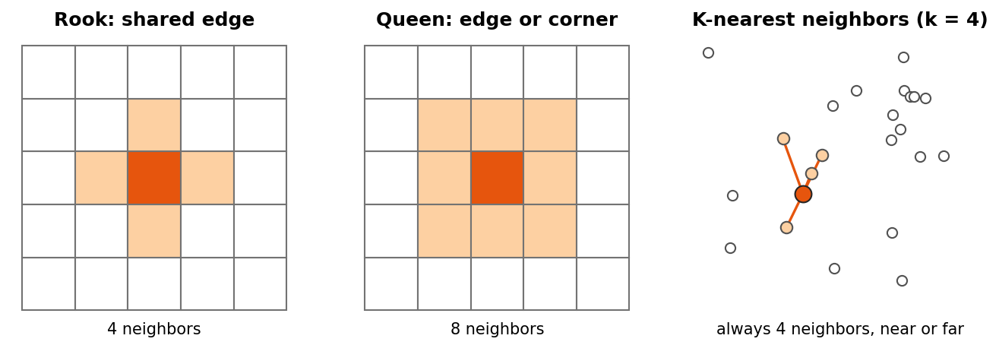

:::::::::::::::::::::::::::::::::::::: questions

- What does it mean for data to be spatially autocorrelated?
- How do we tell the computer which places are neighbors?
- How do Global and Local Moran's I measure and locate clustering?
- What choices and pitfalls affect the results?

::::::::::::::::::::::::::::::::::::::::::::::::

::::::::::::::::::::::::::::::::::::: objectives

- Build Rook, Queen and K-nearest neighbor spatial weights with PySAL
- Compute and interpret Global Moran's I and its p-value
- Read a Moran scatterplot
- Map statistically significant hotspots and coldspots with Local Moran's I (LISA)
- Explain permutation tests, multiple testing and the modifiable areal unit problem

::::::::::::::::::::::::::::::::::::::::::::::::

## Why spatial autocorrelation?

> "Everything is related to everything else, but near things are more related than distant things."
> (Tobler's first law of geography)

Most statistics assume observations are independent. Places are not: a county's income or median
age is usually similar to its neighbors'. **Spatial autocorrelation** measures how strong that
similarity is, and **PySAL** (the Python Spatial Analysis Library) provides the standard tools.

| Question | PySAL method |
|---|---|
| Who counts as a neighbor? | Spatial weights (`libpysal.weights`) |
| Is there clustering across the whole map? | Global Moran's I (`esda.Moran`) |
| Where are the hotspots and coldspots? | Local Moran's I, LISA (`esda.Moran_Local`) |
| Could the pattern be chance? | Permutation tests (`p_sim`) |

In this episode we use 2023 American Community Survey data for Indiana counties, loaded with a
Census API key (see the Census data session for how to get one).

## Why it matters

Spatial autocorrelation is both a problem and a finding.

- **A problem for standard statistics.** Regression and t-tests assume that each observation adds new,
  independent information. When neighbors are similar, Indiana's 92 counties carry less independent
  information than 92 random draws, so standard errors come out too small and results look more significant
  than they are. Spatial regression models (in PySAL's `spreg` package) correct for this.
- **A finding in itself.** Clustering says something about the process behind the data: people with similar
  incomes sort into similar neighborhoods, diseases spread to nearby places, and policies spill across
  borders. Mapping where clusters are is often the first step of a spatial study.

## Spatial weights: who is a neighbor?

Before PySAL can compare a place with its neighbors, you must say who the neighbors are. This is the
**spatial weights matrix** $W$: a table with one row and one column per place, where $w_{ij}$ is not zero
when $j$ is a neighbor of $i$.

{alt="Three panels. Left, Rook contiguity: a 5 by 5 grid of square cells with the center cell in dark orange and the four cells sharing an edge with it (above, below, left and right) in light orange. Middle, Queen contiguity: the same grid with the eight surrounding cells, including the diagonal corners, in light orange. Right, K-nearest neighbors with k equal to 4: scattered points of uneven spacing, one dark orange point joined by lines to its four closest points; the number of neighbors is always four, however near or far they are."}

| Type | Neighbors are | Good for |
|---|---|---|
| **Rook contiguity** | Polygons that share an edge | Regular polygons and grids |
| **Queen contiguity** | Polygons that share an edge or a corner | Most polygon data, such as counties or tracts (the usual default) |
| **K-nearest neighbors (KNN)** | The k closest centers | Points, or polygons of very different sizes; every place gets exactly k neighbors |
| **Distance band** | Every place within a set distance | Points, when "near" has a natural distance |

Two more ideas come up constantly:

- **Row standardization** (`w.transform = "R"`) divides each row by the number of neighbors, so each place's
  weights sum to 1. A county with eight neighbors and a county with three are then treated alike, and
  multiplying the weights by the data gives the **spatial lag**: the average value of each place's
  neighbors.
- **Islands** are places with no neighbors under a contiguity rule, such as an island county. PySAL warns
  about them. Drop them, or give them neighbors with a KNN or distance rule.

:::::::::::::::::::::::::::::::::::::::::::::::::::::::::::::::::::: instructor

Spatial weights are the hardest idea here. Use the chess analogy (Rook moves straight, Queen also
moves diagonally) and draw a 3 by 3 grid before showing code. Also stress that an unfiltered LISA map
(without the p-value cutoff) shows many false hotspots.

::::::::::::::::::::::::::::::::::::::::::::::::::::::::::::::::::::::::::::::::

## 1. Build spatial weights

`counties` is a GeoDataFrame of Indiana counties with a `median_age` column, projected to meters.

```python
from libpysal.weights import Rook, Queen, KNN

w_rook = Rook.from_dataframe(counties, use_index=True)    # shared edge
w_queen = Queen.from_dataframe(counties, use_index=True)  # shared edge or corner
w_knn = KNN.from_dataframe(counties, k=4)                 # 4 closest centers

print(w_rook.mean_neighbors, w_queen.mean_neighbors)
w_queen.transform = "R"    # row standardize: each county's weights sum to 1
```

## 2. Global Moran's I

```python
from esda.moran import Moran

mi = Moran(counties["median_age"], w_queen, permutations=999)
print(f"I = {mi.I:.3f}, p = {mi.p_sim:.3f}")
```

- I clearly above 0 with p below 0.05: similar values cluster together
- I near 0: no spatial pattern
- I below 0: neighbors tend to be different

```python
from splot.esda import moran_scatterplot
moran_scatterplot(mi, aspect_equal=True)
```

### Reading the Moran scatterplot

The scatterplot puts each county's value on the x axis and its **spatial lag** (the average of its
neighbors) on the y axis, both standardized so that 0 is the mean.

- The slope of the fitted line equals Moran's I (with row standardized weights).
- The four quadrants are the categories that LISA uses below: top right **High-High** (a high value among
  high neighbors), bottom left **Low-Low**, top left **Low-High** (a low value among high neighbors) and
  bottom right **High-Low**.
- Points far from the line are places that do not fit the overall pattern, and are worth a closer look.

You can compute the spatial lag yourself:

```python
from libpysal.weights import lag_spatial
counties["lag_median_age"] = lag_spatial(w_queen, counties["median_age"])   # neighbors' average
```

### Could it be chance? Permutation tests

PySAL tests significance by **permutation**. It shuffles the values randomly among the places, for example
999 times, recomputes I for each shuffled map, and counts how often a shuffled map is at least as extreme as
the real one. The pseudo p-value is

$$
p = \frac{M + 1}{R + 1}
$$

where $M$ is the number of shuffled maps at least as extreme as the observed one and $R$ is the number of
permutations. With 999 permutations the smallest possible p-value is 0.001. Because the shuffles are random,
p-values can change slightly from run to run; `Moran_Local` accepts a `seed` so that results are repeatable.

## 3. Local Moran's I (LISA)

```python
from esda.moran import Moran_Local
from splot.esda import lisa_cluster

lisa = Moran_Local(counties["median_age"], w_queen, permutations=999, seed=42)
lisa_cluster(lisa, counties, p=0.05)     # only significant counties are colored
```

Labels: **High-High** (hotspot), **Low-Low** (coldspot), **High-Low** and **Low-High** (outliers),
and **Not significant**.

### Local results need care

Local Moran's I runs one test per place: 92 tests for Indiana counties, and hundreds or thousands for
tracts. With a cutoff of p < 0.05, about 1 place in 20 would look significant even on a completely random
map. To be careful:

- use a stricter cutoff, such as `p=0.01`;
- apply a **False Discovery Rate** (FDR) correction, which lowers the cutoff according to the number of tests;
- treat significant clusters as places to investigate, not as proof.

Getis-Ord Gi* (`esda.G_Local`) is another common hotspot statistic. It finds clusters of high or low values
but does not separate outliers the way LISA does.

:::::::::::::::::::::::::::::::::::: challenge

## Challenge 1: Rook or Queen?

Print the Rook and Queen neighbors of the same county, for example
`w_rook.neighbors[0]` and `w_queen.neighbors[0]`. Why can Queen never have fewer neighbors than Rook?

:::::::::::::::::::::::: solution

Queen counts every county that shares an edge (like Rook) **plus** any that only touch at a corner.
So it always includes all Rook neighbors, and sometimes a few more.

:::::::::::::::::::::::::::::::::
::::::::::::::::::::::::::::::::::::::::::::::::

:::::::::::::::::::::::::::::::::::: challenge

## Challenge 2: A second variable

Compute Global Moran's I for `pct_asian`. Is it clustered? Then make its LISA map.

:::::::::::::::::::::::: solution

```python
mi2 = Moran(counties["pct_asian"], w_queen, permutations=999)
print(mi2.I, mi2.p_sim)
lisa_cluster(Moran_Local(counties["pct_asian"], w_queen, seed=42), counties, p=0.05)
```

A positive I with p below 0.05 means clustering. High-High counties usually sit around large
cities and universities.

:::::::::::::::::::::::::::::::::
::::::::::::::::::::::::::::::::::::::::::::::::

## Pitfalls

- **The modifiable areal unit problem (MAUP).** Results change with the units. The same people aggregated
  to counties, tracts or ZIP codes can show different clusters, or none. State the units you used and, if
  you can, check another.
- **Small numbers.** Rates and estimates for places with small populations swing widely by chance and can
  create false hotspots. American Community Survey estimates for small areas also have large margins of
  error. Look at population sizes and margins of error before interpreting a cluster.
- **Edge effects.** Places on the edge of the study area, such as border counties, have fewer neighbors, so
  their local statistics rest on less information.
- **The weights are a choice.** Rook, Queen and KNN can give different answers. Try more than one; robust
  patterns survive the change.
- **Clustering is not causation.** A High-High cluster of median age says where older populations are, not
  why.

:::::::::::::::::::::::::::::::::::: challenge

## Challenge 3: An outlier tract

A LISA map of median household income for Marion County tracts shows one tract labeled **High-Low**. What
does that label mean, and what could explain it? What would you check before writing about it?

:::::::::::::::::::::::: solution

High-Low means the tract's income is well above the mean while its neighbors' average is below the mean,
and the difference is unlikely to be chance under the permutation test. It could be a new upscale
development, a gentrifying area, or an affluent enclave next to lower-income neighborhoods. It could also be
a statistical artifact: check the tract's population and the estimate's margin of error, because a small
tract with a large margin of error can produce an extreme value by chance. With hundreds of tracts, also
remember that about 1 in 20 can be significant at p < 0.05 by chance alone.

:::::::::::::::::::::::::::::::::
::::::::::::::::::::::::::::::::::::::::::::::::

## Math

Global Moran's I is

$$
I = \frac{N}{W} \cdot \frac{\sum_i \sum_j w_{ij}(x_i - \bar{x})(x_j - \bar{x})}{\sum_i (x_i - \bar{x})^2}
$$

where $N$ is the number of places, $w_{ij}$ is the weight between places $i$ and $j$ (non zero only
for neighbors), $W$ is the sum of all weights, and $x$ is the variable. The top of the fraction is
large when neighbors are on the same side of the mean.

::::::::::::::::::::::::::::::::::::: keypoints

- Spatial weights define who is a neighbor: Rook (edges), Queen (edges and corners), KNN (closest)
- Global Moran's I gives one number for clustering across the whole map
- The permutation p-value tells you whether the pattern could be chance
- Local Moran's I (LISA) locates hotspots, coldspots and outliers; always filter by p-value
- Many local tests produce false positives; use stricter cutoffs or FDR, and treat clusters as leads
- Results depend on the units (MAUP), the weights, small populations and edges of the study area

::::::::::::::::::::::::::::::::::::::::::::::::

## Notebooks

| Level | Notebook | What you will do |
|---|---|---|
| Beginner | <a href="https://colab.research.google.com/github/SpatialTurn/DataAnalysis/blob/main/notebooks/02a_Spatial_Weights_Neighbors.ipynb" target="_blank">2a. What Is a Neighbor? Spatial Weights</a> | Load Indiana counties and compare Rook, Queen and KNN neighbors |
| Intermediate | <a href="https://colab.research.google.com/github/SpatialTurn/DataAnalysis/blob/main/notebooks/02b_Global_Morans_I.ipynb" target="_blank">2b. Global Moran's I</a> | Test whether median age is clustered and read the Moran scatterplot |
| Advanced | <a href="https://colab.research.google.com/github/SpatialTurn/DataAnalysis/blob/main/notebooks/02c_Local_Morans_I_Hotspots.ipynb" target="_blank">2c. Local Moran's I and Hotspots</a> | Map significant clusters for counties, then for Marion County tracts |
