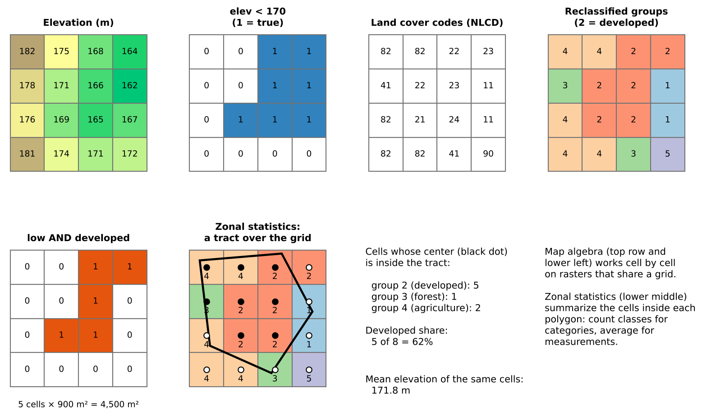
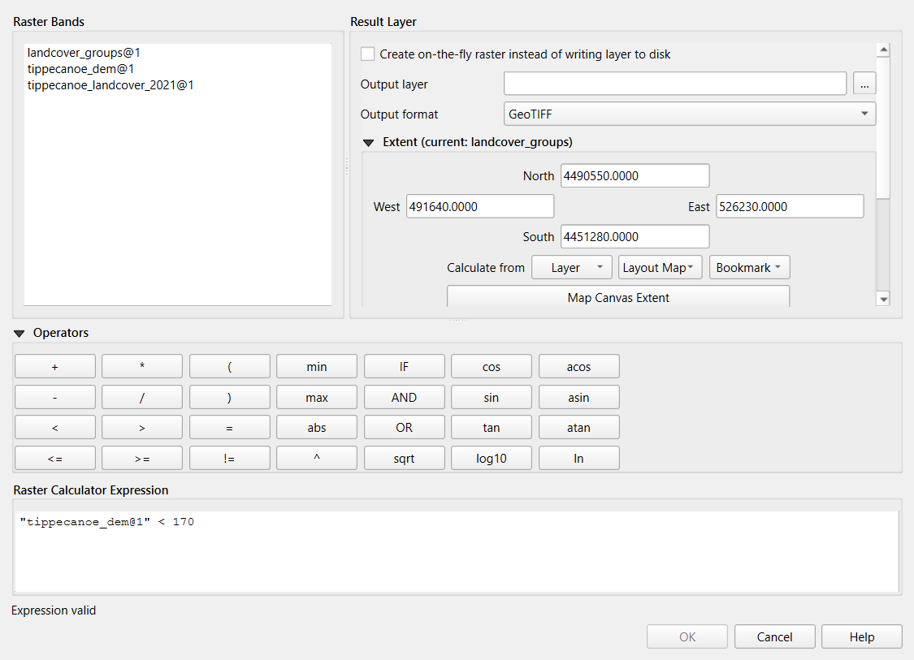
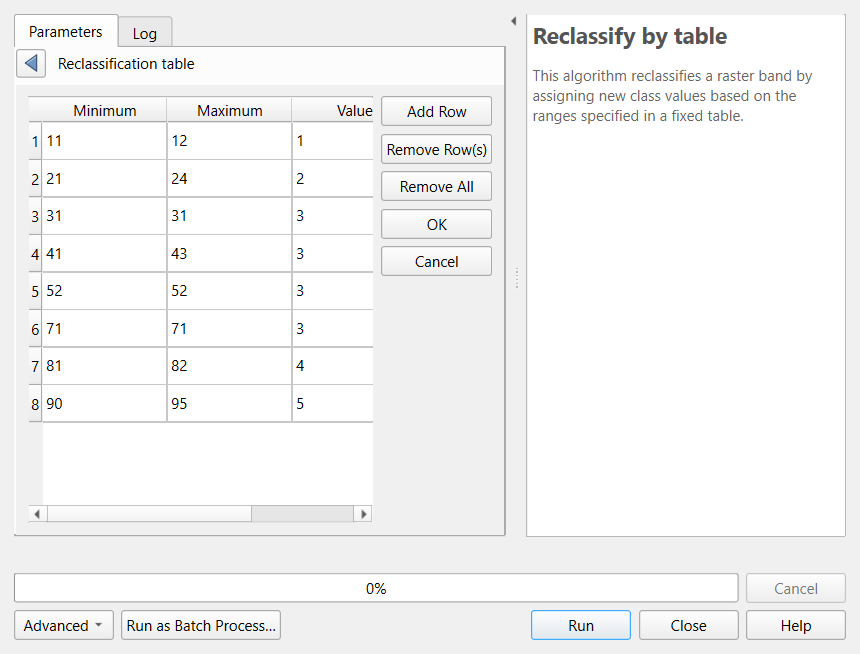
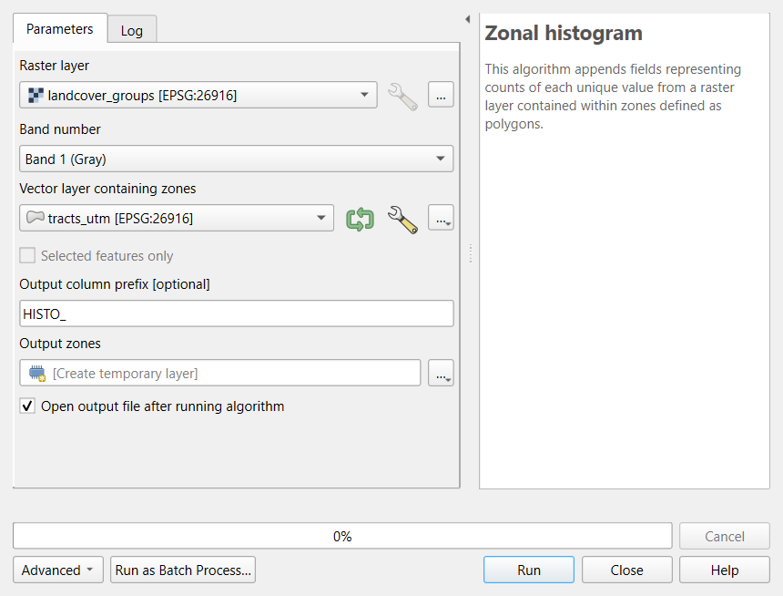
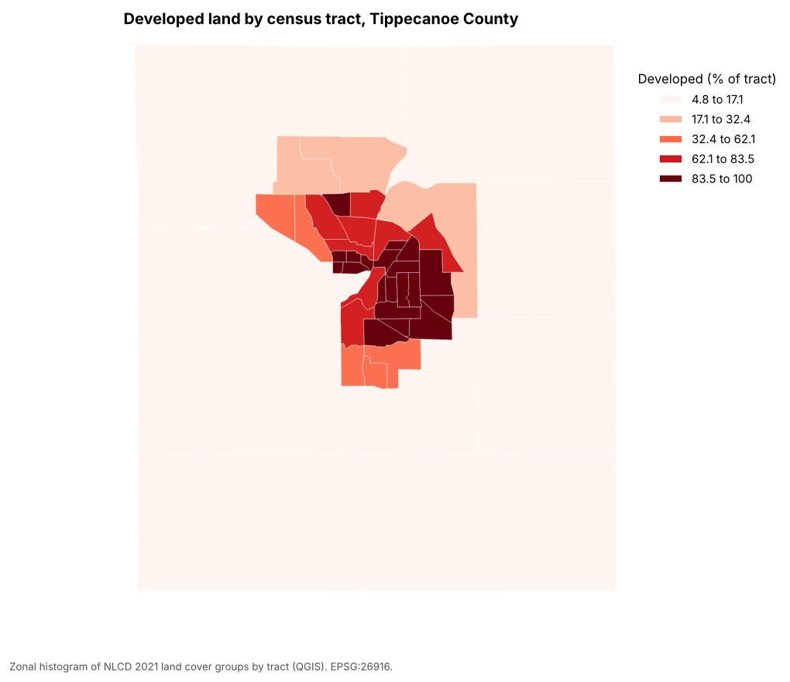

:::::::::::::::::::::::::::::::::::::: questions

- How do I combine and reclassify rasters cell by cell?
- How do I summarize a raster inside polygons such as census tracts?
- How can land cover improve population estimates?

::::::::::::::::::::::::::::::::::::::::::::::::

::::::::::::::::::::::::::::::::::::: objectives

- Explain when rasters line up, and choose a resampling method for measurements and categories
- Make Boolean rasters with comparisons, reclassify categories with a lookup table, and combine rasters
- Compute zonal statistics for measurements and class shares for categories
- Use the Raster Calculator, Reclassify by table, Zonal statistics and Zonal histogram in QGIS

::::::::::::::::::::::::::::::::::::::::::::::::

## What raster analysis adds

Vector operations ask where features are. Raster analysis asks what is **everywhere**: the elevation of every
30 m cell, the land cover of every cell, the temperature or vegetation index across a whole city. Two families of
operations cover most everyday work:

- **Map algebra** combines rasters cell by cell to make new rasters: arithmetic (elevation in feet), comparisons
  (land below 170 m), logic (low **and** developed) and **reclassification** (16 land cover codes into 5 groups).
- **Zonal statistics** summarize the cells inside polygons and write the result into the polygons' table: the
  mean elevation of each tract, or how many of its cells are developed. This is how raster data meets Census
  data.

{alt="Diagram of eight panels. Top row: a 4 by 4 grid of elevations from 162 to 182 meters; the same grid after the comparison elevation less than 170, showing 1 in seven cells on the lower, right side and 0 elsewhere; a grid of NLCD land cover codes such as 82, 22, 23, 11, 41 and 90; and the same grid reclassified into groups 1 to 5, with group 2 (developed) in red. Bottom row: the cells that are both low and developed, five cells marked 1, with the note 5 cells times 900 square meters equals 4,500 square meters; the reclassified grid with a tract polygon drawn over it and a dot at the center of each cell, black where the center falls inside the polygon; a summary saying that of 8 cells whose centers are inside, 5 are developed, 1 forest and 2 agriculture, a developed share of 62 percent, and that the mean elevation of the same cells is 171.8 meters; and a short note that map algebra works cell by cell on rasters that share a grid while zonal statistics summarize the cells inside each polygon."}

This episode asks two questions about Tippecanoe County, Indiana:

1. How much **developed land lies close to river level**, below 170 m? (A rough stand-in for land near the
   Wabash River. It is not a flood map; FEMA flood zones are the real source for that.)
2. How **developed** is each census tract, and how does that relate to where people live?

## Rasters must line up

Map algebra compares cell (row 10, column 20) of one raster with cell (row 10, column 20) of another, so both
must describe the same piece of ground: the same **CRS**, the same **cell size** and the same **extent and
alignment**. The two rasters in this episode were prepared that way (EPSG:26916, 30 m cells, one grid). Real
data rarely is, and aligning it means **resampling**:

| Data | Resampling method | Why |
|---|---|---|
| Measurements (elevation, temperature) | Bilinear or cubic | Averages neighboring values smoothly |
| Categories (land cover, zoning codes) | **Nearest neighbor** | Averaging codes would invent classes that do not exist (the mean of 21 and 41 is 31, "barren") |

Resample as few times as possible, and to the coarser of the two resolutions: resampling to finer cells adds no
information.

## Map algebra in four kinds

Map algebra operations are often grouped by how many cells feed each output cell:

| Kind | Each output cell uses | Example |
|---|---|---|
| **Local** | The same cell in one or more rasters | `elev < 170`, `low AND developed`, reclassification |
| **Focal** | A neighborhood around the cell | Slope, hillshade, a 3 by 3 average (Workshop Session 2A's DEM analysis) |
| **Zonal** | All cells in the same zone | Mean elevation per tract |
| **Global** | The whole raster | Distance to the nearest river cell |

This episode uses local and zonal operations.

## Reclassification

**Reclassification** maps old values to new ones with a table. For categories it groups detailed classes; for
measurements it cuts a continuous range into classes (0 to 2% slope = flat, and so on). Two checks prevent
silent errors:

- **Every value must be covered.** A code missing from the table becomes no data (or keeps its old value,
  depending on the software), and the totals no longer add up.
- **Range boundaries matter.** "11 to 12" can mean 11 < value ≤ 12 or 11 ≤ value ≤ 12. For whole-number codes
  include both ends.

The groups used here:

| Group | NLCD codes | Meaning |
|---|---|---|
| 1 Water | 11, 12 | Open water, ice |
| 2 Developed | 21 to 24 | Open space (lawns, parks) to high intensity (downtown, industry) |
| 3 Forest and natural | 31, 41 to 43, 52, 71 | Barren, forest, shrub, grassland |
| 4 Agriculture | 81, 82 | Pasture and crops |
| 5 Wetlands | 90, 95 | Woody and herbaceous wetlands |

## Zonal statistics

Zonal statistics need the polygons and the raster in the **same CRS** (software may reproject on the fly, but
doing it yourself avoids surprises). Choose the statistic by the kind of raster:

- **Measurements:** mean, minimum, maximum, range, standard deviation.
- **Categories:** **count of each class** (a zonal histogram), then shares. Never average land cover codes.

Most tools count a cell if its **center** falls inside the polygon. For large polygons this hardly matters; for
polygons only a few cells wide (a small park, a narrow tract) the result can be off by a lot. Use finer data,
an "all touched" option, or report the limitation.

## From land cover to people: dasymetric estimation

In the Geoprocessing episode, **areal weighting** spread each tract's population evenly over its area. Land
cover lets us do better: people live on developed land, so a piece of a tract that is all farmland should get
few of its residents. **Dasymetric estimation** splits each tract's population in proportion to its
**developed cells** rather than its area. For Lafayette and West Lafayette it raises the estimated city
population from about 114,000 to about 122,000 (edge tracts are partly farmland outside the city limits), while
the **share** within 1 mile of a supermarket barely moves (68% either way). Comparing two methods like this
shows how much a conclusion depends on an assumption.

## Pitfalls

- **No data.** Cells outside the county hold a no-data value (here 0 for land cover, -9999 for elevation).
  Count or average them by mistake and every statistic shifts.
- **Units.** Areas come from cell counts × cell area, which is only meaningful in a CRS measured in meters.
- **Resolution versus polygon size.** A 30 m raster says little about a 50 m wide parcel.
- **Classification error.** Land cover maps come from satellite classification and contain errors, especially
  between similar classes (pasture and grassland, low and medium intensity developed). Check suspicious results
  against imagery.
- **Date.** NLCD 2021 and ACS 2020-2024 are close in time; mixing data decades apart is not.

---

## Hands-on

These steps were checked in QGIS 4.0 (QGIS 3.34 and later are nearly identical). Save a new project in its own
folder first; raster results are written there.

### Part 1: Load the rasters from the web

1. **Layer > Add Layer > Add Raster Layer**. **Source Type:** Protocol: HTTP(S), cloud, etc. **Type:**
   HTTP/HTTPS/FTP. **URI:**
   `https://raw.githubusercontent.com/SpatialTurn/Foundations/main/data/tippecanoe_dem.tif`. Click **Add**.
2. Repeat with `https://raw.githubusercontent.com/SpatialTurn/Foundations/main/data/tippecanoe_landcover_2021.tif`.
3. Load the tracts as a vector layer:
   `https://raw.githubusercontent.com/SpatialTurn/Foundations/main/data/tippecanoe_tracts_acs.geojson`.

**Check:** the land cover appears in the official NLCD colors (the file carries its color table), and the
elevation in gray, dark in the Wabash valley. Right-click the elevation layer > **Properties > Information**:
CRS EPSG:26916, pixel size 30 by 30.

### Part 2: Land below 170 m (Raster Calculator)

1. **Raster > Raster Calculator**.
2. In **Raster Bands**, double-click `tippecanoe_dem@1` to insert it, then type ` < 170` so the expression reads
   `"tippecanoe_dem@1" < 170`.
3. **Output layer:** click **...** and save as `low.tif` in your project folder (or tick **Create on-the-fly
   raster** to skip saving). **OK** stays gray until an output is set.
4. Click **OK**.

{alt="Screenshot of the QGIS Raster Calculator. The Raster Bands list shows tippecanoe_dem@1 and tippecanoe_landcover_2021@1 (and a landcover_groups@1 layer from a later step). The Result Layer section has an empty Output layer box with a browse button, Output format GeoTIFF, and the extent of the layer. Operator buttons include plus, minus, less than, AND, OR, IF, min, max and math functions. The expression box reads tippecanoe_dem@1 in double quotes, less than 170, and the message below says Expression valid."}

The result has 1 where the comparison is true and 0 where it is false.

**Check:** in the Processing Toolbox, run **Raster layer unique values report** on `low`. Value 1 covers
**96,559 cells, about 86.9 km²**.

### Part 3: Group the land cover (Reclassify by table)

1. Processing Toolbox: **Reclassify by table**. **Raster layer:** `tippecanoe_landcover_2021`.
2. **Reclassification table:** click **...** and add eight rows (**Add Row**) with Minimum, Maximum and Value as
   in the table above: 11, 12, 1 / 21, 24, 2 / 31, 31, 3 / 41, 43, 3 / 52, 52, 3 / 71, 71, 3 / 81, 82, 4 /
   90, 95, 5. Click the back arrow to return.
3. Open **Advanced Parameters**. **Range boundaries:** `min <= value <= max` (the default `min < value <= max`
   would skip codes 11, 21, 31 and so on). Tick **Use NoData when no range matches value**. **Output data
   type:** Byte.
4. Save the output as `landcover_groups.tif` and click **Run**.

{alt="Screenshot of the QGIS Reclassify by table tool showing the Reclassification table panel. Eight rows list Minimum, Maximum and Value: 11, 12, 1; 21, 24, 2; 31, 31, 3; 41, 43, 3; 52, 52, 3; 71, 71, 3; 81, 82, 4; 90, 95, 5. Buttons on the right are Add Row, Remove Row(s), Remove All, OK and Cancel."}

**Check:** the unique values report on `landcover_groups` shows five values: 1 about 10.8 km², 2 about
196.8 km², 3 about 167.1 km², 4 about 904.0 km², 5 about 23.4 km². If group 1 or 2 is much smaller, check the
range boundaries.

### Part 4: Developed land below 170 m

1. **Raster > Raster Calculator** again, with the expression
   `("low@1" = 1) AND ("landcover_groups@1" = 2)`, saved as `low_developed.tif`.
2. Run the unique values report on it.

**Check:** value 1 covers about **10.7 km²**, about 5% of the county's 196.8 km² of developed land.

### Part 5: Mean elevation per tract (Zonal statistics)

1. Reproject the tracts to the rasters' CRS: **Vector > Data Management Tools > Reproject Layer**, target
   **EPSG:26916**, and rename the result `tracts_utm`.
2. Processing Toolbox: **Zonal statistics** (in the Raster analysis group). **Input layer:** `tracts_utm`.
   **Raster layer:** `tippecanoe_dem`. **Output column prefix:** `elev_`. **Statistics to calculate:** tick
   **Mean**, **Minimum** and **Maximum**. Run.

**Check:** the new layer has `elev_mean`, `elev_min` and `elev_max`. Census Tract 1 has a mean of about
**165.6 m**, one of the lowest, close to the river.

### Part 6: Percent developed per tract (Zonal histogram)

1. Processing Toolbox: **Zonal histogram**. **Raster layer:** `landcover_groups`. **Vector layer containing
   zones:** the output of Part 5 (or `tracts_utm`). Leave the prefix as `HISTO_`. Run.

{alt="Screenshot of the QGIS Zonal histogram tool. Raster layer is landcover_groups in EPSG:26916, Band number is Band 1, Vector layer containing zones is tracts_utm in EPSG:26916, Output column prefix is HISTO_, and the output is a temporary layer. The help panel says the algorithm appends fields with counts of each unique value from a raster layer within zones defined as polygons."}

2. The output has one column per group: `HISTO_1` to `HISTO_5` (cell counts), plus `HISTO_NODATA`.
3. In its attribute table, open the **Field Calculator** and create `pct_developed`, **Decimal Number (real)**:

   ```
   "HISTO_2" / ("HISTO_1" + "HISTO_2" + "HISTO_3" + "HISTO_4" + "HISTO_5") * 100
   ```

**Check:** the lowest value is Census Tract 110 at about **4.8%**; the median is about 82%, and several downtown
tracts are 100%.

### Part 7: Map it

Style the result with **Graduated** symbology on `pct_developed`, **Natural Breaks (Jenks)**, 5 classes, a
sequential ramp such as **Reds**.

{alt="Choropleth map of Tippecanoe County census tracts titled Developed land by census tract. Five classes in shades of red from 4.8 to 17.1 percent (palest) to 83.5 to 100 percent (darkest). The large rural tracts that fill most of the county are palest; the tracts of Lafayette and West Lafayette in the center are darkest, and a ring of tracts around them is in the middle classes."}

Compare it with a map of population density (`total_pop` divided by the tract area): the patterns are very
similar. That is why land cover is useful for placing people within tracts, the idea behind dasymetric
estimation. The [Python version](raster-python.md) (notebook 2b) carries out the dasymetric estimate.

---

:::::::::::::::::::::::::::::::::::: challenge

## Challenge 1: Which resampling?

You need to combine a 10 m land cover raster with a 30 m elevation raster. Which raster would you resample,
to what cell size, and with which method? (In QGIS: **Raster > Projections > Warp (Reproject)** has a
**Resampling method** option.)

:::::::::::::::: solution

Resample the **land cover** to **30 m** (the coarser resolution), with **nearest neighbor** (**Nearest Neighbour** in the Warp dialog), because it holds
categories: bilinear would average codes into classes that do not exist. Resampling the elevation to 10 m
would create a finer grid without adding information.

:::::::::::::::::::::::::

::::::::::::::::::::::::::::::::::::::::::::::::

:::::::::::::::::::::::::::::::::::: challenge

## Challenge 2: A different threshold

Repeat Parts 2 and 4 with **175 m**. How much developed land lies below it? Is the answer sensitive to the
threshold?

:::::::::::::::: solution

`"tippecanoe_dem@1" < 175`, then the AND step: about **15.3 km²** (compared with 10.7 km² below 170 m). Five
meters of threshold add about 40%, so the result is quite sensitive, which is one more reason to use a real
flood map for decisions.

:::::::::::::::::::::::::

::::::::::::::::::::::::::::::::::::::::::::::::

:::::::::::::::::::::::::::::::::::: challenge

## Challenge 3: Mean or count?

For each tract you want (a) its average elevation, (b) its share of forest, and (c) its most common land cover
class. Which QGIS tool and statistic gives each?

:::::::::::::::: solution

(a) **Zonal statistics**, Mean, on the elevation raster. (b) **Zonal histogram** on the land cover (or the
groups), then forest cells divided by all cells in the Field Calculator. (c) **Zonal statistics**, **Majority**,
on the land cover raster. Never the Mean of land cover codes.

:::::::::::::::::::::::::

::::::::::::::::::::::::::::::::::::::::::::::::

::::::::::::::::::::::::::::::::::::: keypoints

- Rasters combined cell by cell must share CRS, cell size and extent; resample categories with nearest neighbor
- The Raster Calculator makes comparisons and combines conditions (`AND`, `OR`); results are 1 and 0
- Reclassify by table groups codes; set the range boundaries to `min <= value <= max` for whole-number codes
- Zonal statistics summarize measurements per polygon; Zonal histogram counts categories per polygon
- Check results with the unique values report: cells times 900 m² gives areas

::::::::::::::::::::::::::::::::::::::::::::::::
